# Abstract {.unnumbered}

Forecast reconciliation ensures coherence among forecasts of hierarchically related series, but forecast accuracy may also depend on the reconciliation method and the information used. This thesis proposes Forecasting with Linear Augmented Information Combination (FLAIC), extending the Information Combination (IComb) framework by incorporating separately generated forecasts of principal components constructed from the hierarchy. We evaluate ridge and multivariate lasso variants using 112 Australian domestic tourism series across horizons of 1–12 months, varying PCA preprocessing and augmentation dimensions. Benchmarks include IComb, conventional reconciliation methods and a hierarchy-adapted Forecast Linear Augmented Projection (FLAP). FLAIC generally improves upon base forecasts, and FLAIC-L achieves the lowest raw-error loss. However, improvements over IComb are specification-dependent and not consistently statistically significant. Augmentation improves accuracy more frequently under ridge than lasso, while including all 77 components consistently worsens performance relative to IComb. These findings highlight the importance of the number and construction of components and how their forecasts are combined with the hierarchy base forecasts.

**Keywords:** Hierarchical time series; forecast reconciliation; principal components; regularised regression; component augmentation.

\newpage

# Declaration and Acknowledgements {.unnumbered}

I declare that this thesis is my own original work and has not been submitted, in whole or in part, for the award of any other degree or qualification at this or another institution. To the best of my knowledge, this thesis contains no material previously published or written by another person, except where appropriate acknowledgement and reference have been provided.

**Student name:** Branesh Prakash

**Student signature:** *Branesh Prakash*

**Date:** 18 October 2026

## Reproducibility statement {.unnumbered}

This thesis was prepared using Quarto, with the empirical analysis conducted in R. The analysis includes data preparation, principal component construction, forecast generation, reconciliation, evaluation and presentation of results. The R code and supporting materials for reproducing the empirical analysis will be made available in the following GitHub repository:

<https://github.com/branesh97/flaic-honours-thesis>

The repository will include the relevant scripts and instructions for reproducing the results, together with information on the required data and software packages.

**Declaration of AI Use:** Generative AI tools, primarily ChatGPT, were used to assist with the development and refinement of R code for this thesis. I developed the baseline implementation of FLAIC and used AI interactively to seek guidance on specific programming tasks and implementation approaches. This included assistance with producing graphs, implementing parallelisation, organising R scripts, managing and saving outputs, and troubleshooting code. AI was also used to provide editorial support on my drafts, including suggestions for improving the clarity, structure and phrasing of thesis text, which I reviewed, revised and adapted. The methodological decisions, empirical analysis, interpretation of results and final content of this thesis were and remain my responsibility.

**Acknowledgements:** I extend my sincere gratitude to my supervisors, Dr Shanika L. Wickramasuriya and Professor George Athanasopoulos, for giving me the opportunity to undertake this research project and for their invaluable guidance throughout.

I am particularly grateful to Dr Wickramasuriya for generously dedicating her time to helping me understand technical and methodological concepts, providing detailed and constructive feedback on my drafts and ideas, and patiently addressing my many questions. Her guidance has been instrumental in developing my understanding of hierarchical forecasting and in shaping this research.

I am equally grateful to Professor Athanasopoulos for his insightful comments during our discussions and for asking probing questions that encouraged me to think more critically about my research. I also greatly appreciate his guidance on structuring the project, managing my time effectively and improving computational efficiency, particularly through his encouragement to implement parallelisation in R.

**Note:** Any remaining errors or omissions are entirely my own.

\newpage

# Introduction {#sec-intro}

Forecasts are often required for quantities that are related through known aggregation constraints. For example, forecasts of regional tourism should add to national tourism, product-level sales should add to category-level sales, and forecasts of expenditure components should add to total expenditure. However, when forecasts are produced independently, these relationships are usually violated. Forecast reconciliation addresses this problem by combining or adjusting forecasts so that they satisfy the underlying constraints. Yet achieving coherence is only part of the forecasting problem: forecasts must also be accurate. Their accuracy may depend not only on how existing forecasts are combined, but also on the forecast information available for combination. This motivates examining whether forecasts of constructed linear combinations of the original series can provide useful additional inputs for improving hierarchical forecast reconciliation.

A hierarchical time series is a multivariate time series obeying some known linear constraints [@athanasopoulos2024], which are typically aggregation constraints. Such structures naturally arise in forecasting applications where predictions are required at multiple levels of aggregation. More broadly, forecast reconciliation can be applied to grouped structures with multiple aggregation paths, temporal hierarchies linking different sampling frequencies [@athanasopoulos2017], cross-temporal structures [@difonzo2023], and multivariate series subject to more general linear constraints, such as those considered by @li2021 in mortality forecasting. In this thesis, we focus on cross-sectional hierarchical time series characterised by aggregation constraints.

Traditionally, hierarchical time series forecasting methods involved generating forecasts for a single level of the hierarchy and obtaining forecasts for the remaining levels through aggregation or disaggregation. In the bottom-up approach, forecasts are generated for the most disaggregated series and aggregated upwards. In contrast, the top-down approach starts with forecasts of the most aggregated series and distributes them to lower levels using proportions, while the middle-out approach combines these ideas. Although bottom-level forecasts may contain detailed information, they can be noisy and volatile, whereas top-level forecasts may capture smoother movements but overlook information available at lower levels. Thus, forecasting from a single hierarchy level risks ignoring useful information present elsewhere in the hierarchy.

Recognising these limitations, @hyndman2011 proposed the optimal combination approach, which generates forecasts for all series in the hierarchy, referred to as base forecasts, and combines them through a linear regression to produce coherent reconciled forecasts. This is referred to as ordinary least squares (OLS) reconciliation. Subsequently, @wickramasuriya2019 developed the Minimum Trace (MinT) reconciliation approach, which minimises the trace of the reconciled forecast error covariance matrix subject to a constraint that preserves unbiasedness. Specifically, if the base forecasts are unbiased conditional on all information available when they are produced, this constraint ensures that the reconciled forecasts remain unbiased. MinT provides a covariance-based solution for transforming base forecasts into coherent forecasts, and is also equivalent to generalised least squares (GLS) reconciliation despite the different optimisation formulations [@wickramasuriya2021a]. Other linear point forecast reconciliation approaches, including OLS, weighted least squares (WLS) with variance scaling [@hyndman2016] and WLS with structural scaling [@athanasopoulos2017], can be viewed as special cases of the MinT framework under particular choices of the base forecast error covariance matrix [@wickramasuriya2019]. A practical difficulty is that this covariance matrix must be estimated from historical forecast errors, which can be challenging when the number of hierarchy series is large relative to the available observations, motivating the use of shrinkage estimators.

A useful interpretation is provided by @panagiotelis2021, who view forecast reconciliation from a geometric perspective and show that commonly used reconciliation methods belong to a general class of projections, with forecast accuracy improvements guaranteed under particular loss functions and conditions. As base forecasts generally lie outside the coherent subspace whereas actual future values lie inside it, mapping incoherent base forecasts onto the coherent subspace can improve accuracy. Thus, forecast reconciliation is valuable not only because it ensures coherence, but also because it can improve forecast accuracy. This provides further motivation for developing reconciliation methods that combine forecasts more effectively.

The hierarchical forecast reconciliation literature has since expanded in several directions, including probabilistic hierarchical forecasting, Bayesian formulations, machine-learning and regularisation approaches, and methods for temporal and cross-temporal reconciliation. These methods have been applied in fields such as tourism, macroeconomics, energy, retail and healthcare. An extensive review is provided by @athanasopoulos2024. In this thesis, we focus on linear point forecast reconciliation, paying particular attention to how reconciliation can be viewed as combining forecasts or information.

Recent developments have increasingly moved beyond unbiasedness-preserving constraints, recognising that the assumption of conditional unbiasedness may be restrictive in practice. In particular, base forecasts are often produced using univariate models that rely on the history of each individual series, rather than the full information set of the hierarchy. @bentaieb2019 formulate reconciliation as an empirical risk minimisation problem that directly minimises mean squared forecast error, allowing reconciled forecasts to reflect a bias–variance trade-off. They introduce regularisation to address the difficulties of estimating large reconciliation mappings. Similarly, @wang2025 investigate forecast reconciliation with time series selection, recognising that some base forecasts may be poor because of model misspecification or low forecastability. Their approaches allow less useful base forecasts to be excluded when forming coherent forecasts, under formulations that either retain or relax the unbiasedness-preserving constraint.

In a related development, @wickramasuriya2021a examine unconstrained MinT reconciliation and show that relaxing the unbiasedness constraint can reduce mean squared forecast error, although estimating the unrestricted reconciliation mapping may be unstable in small samples. The Information Combination (IComb) framework of @nguyen2025a develops this empirical perspective further by treating reconciliation as a multivariate regression problem. Rather than relying solely on forecast error covariances to determine how base forecasts should be combined, IComb uses historical forecasts and realised coherent outcomes to estimate a combination of forecasts directly. Since the response variables are the realised hierarchy series, which are coherent by construction, and the same predictor set is used across equations, the resulting fitted and reconciled forecasts are coherent. When all hierarchy base forecasts are used as predictors, the unregularised IComb formulation is equivalent to the empirical unconstrained MinT approach. To address estimation instability, @nguyen2025a consider regularised estimators, including ridge and multivariate lasso. An attractive feature of the IComb framework is the flexibility of its predictor set, providing scope to incorporate forecasts beyond those of the observed hierarchy series.

In a separate development, @yang2024a propose Forecast Linear Augmented Projection (FLAP), which shows how the forecast error variance of a multivariate series can be reduced by augmenting its original forecasts with forecasts of constructed linear components. The method does not require additional underlying data; it involves forming linear combinations of the original series, forecasting these components separately, and recovering revised forecasts of the original series through a projection of the component-augmented forecasts. Under the population covariance-based projection, FLAP provides forecast error variance reductions that are non-decreasing as more components are introduced. Importantly, although the components are constructed from the original series, their separately generated forecasts need not be equivalent to linear combinations of the original forecasts. Therefore, component forecasts may contain complementary predictive information not fully reflected in the original forecasts. However, the multivariate series considered in the standard FLAP framework do not have pre-existing aggregation constraints.

This presents an opportunity to investigate component augmentation within hierarchical forecast reconciliation. Existing methods have examined how to enforce coherence and how to optimally weight, combine or select among forecasts of the observed hierarchy series. However, relatively little attention has been given to whether forecasts of constructed linear components can be incorporated into this reconciliation process to improve accuracy. Motivated by FLAP [@yang2024a], we propose expanding the forecast inputs considered during reconciliation to include forecasts of appropriately constructed linear combinations of the hierarchy series. The IComb framework [@nguyen2025a] provides a suitable setting for this extension because its multivariate regression formulation permits an expanded predictor set while maintaining coherence without imposing an unbiasedness-preserving constraint.

Specifically, we propose Forecasting with Linear Augmented Information Combination (FLAIC), which augments the hierarchy base forecasts used in IComb with separately generated forecasts of principal components. The components are constructed using Principal Component Analysis (PCA), allowing us to represent different patterns of variation across the hierarchy. The motivation is that certain linear combinations may exhibit more forecastable dynamics than the individual series, so forecasting them separately may provide useful predictive information not fully captured by the hierarchy base forecasts. However, the benefits are not guaranteed. Although principal components are orthogonal by construction, their separately generated forecasts need not be orthogonal to one another or to the hierarchy base forecasts. Furthermore, augmentation increases the number of predictors and coefficients to be estimated, which may adversely affect out-of-sample accuracy.

Against this background, our central research question is: *To what extent can forecasts of constructed linear components improve the accuracy of hierarchical forecasts when incorporated into the Information Combination framework?*

The main contribution of this thesis is methodological. We propose FLAIC as an extension of the existing IComb framework, allowing component forecasts to be incorporated into coherent hierarchical forecasting without requiring external data. We estimate the FLAIC regression coefficient matrix using ridge and multivariate lasso regularisation, referring to the resulting methods generally as FLAIC-S and FLAIC-L, respectively. We investigate how their forecasting performance depends on the number of components and the centring and scaling treatments used in PCA. Additionally, we develop a hierarchy-adapted FLAP benchmark that incorporates both the aggregation constraints of the hierarchy and the restrictions implied by the constructed components through a forecast-error-covariance-based oblique projection. Since this formulation reduces to MinT when no components are introduced, it provides a useful comparison of component augmentation under a covariance-based projection and the IComb regression framework.

We evaluate the forecasting performance of FLAIC using Australian domestic tourism data, comprising 112 monthly series across four hierarchy levels over January 1998 to December 2019. To provide a comparable assessment of the effects of augmentation, our empirical design closely follows @nguyen2025a, using the same tourism hierarchy, sample period and ETS-based forecasting framework. We implement a rolling-window evaluation with 120-month training windows and forecast horizons of 1–12 months. We consider four PCA centring and scaling specifications and eight augmentation dimensions, ranging from one to 77 components. We compare FLAIC with conventional reconciliation methods, IComb and the hierarchy-adapted FLAP benchmark. We also investigate forecast performance across origins and hierarchy levels, conduct statistical comparisons, examine component predictor selection under multivariate lasso and assess robustness to alternative measures of forecast accuracy.

Our empirical findings indicate that component augmentation can improve forecast accuracy, but its benefits relative to IComb depend on the specification considered. Under raw squared forecast errors, FLAIC generally outperforms the original hierarchy base forecasts and conventional reconciliation methods, with FLAIC-L achieving the lowest overall PRIAL among the methods considered. However, improvements relative to the corresponding IComb benchmarks are not consistent across PCA specifications, augmentation dimensions and forecast horizons. Such improvements are more widespread under ridge regularisation, particularly with low or moderate augmentation. A clear finding is that high augmentation tends to deteriorate forecast accuracy. At the maximum augmentation dimension of 77 components, FLAIC performs worse than its corresponding IComb benchmark across all PCA specifications and individual forecast horizons, under both ridge and lasso regularisation. Furthermore, statistical comparisons provide limited evidence that component augmentation consistently improves forecast accuracy relative to IComb. The hierarchy-adapted FLAP results suggest that the effects of augmentation also depend on the method used to combine the additional forecasts. Finally, the relative ranking of ridge and lasso changes when forecast errors are scaled to account for differences in magnitude across hierarchy series. Taken together, these findings indicate that FLAIC can improve upon IComb under selected specifications, but these improvements are not consistently statistically significant, and including many components generally worsens forecast accuracy. The results highlight the importance of the number and construction of components and how their forecasts are combined with the hierarchy base forecasts.

The remainder of this thesis is organised as follows. @sec-method introduces the relevant reconciliation frameworks and develops the FLAIC method and hierarchy-adapted FLAP benchmark. @sec-emp describes the empirical design, data, results and discussion. @sec-conclude summarises the main findings, limitations and directions for future research.

# Methodology {#sec-method}

## Forecasting hierarchical time series {#sec-setup}

Adopting notation used by @athanasopoulos2024, we define a hierarchical time series as a multivariate time series vector $\bold y_t \in \mathbb R^n$, indexed by time $t$, and stacked so that the top $n_a$ ($n_a<n$) series, denoted by $\bold a_t$, are aggregates of the $n_b = n - n_a$ most disaggregated bottom-level series, denoted by $\bold b_t$. The $n_a \times n_b$ aggregation matrix $\bold A$ captures the linear constraints between $\bold a_t$ and $\bold b_t$:

$$\bold a_t= \bold A \bold b_t$$ {#eq-agg_matr_coh}

This gives us the following structural representation

$$\bold y_t= 
\begin{bmatrix}
\bold a_t \\
\bold b_t
\end{bmatrix}
=\bold S\bold b_t,~
\bold S=
\begin{bmatrix}
\bold A \\
\bold I_{n_b}
\end{bmatrix}~~\mathrm {for~all}~t,$$ {#eq-struc_rep}

where $\bold S$ is referred to as the $n \times n_b$ 'summing' or 'structural' matrix transforming $\bold b_t$ to $\bold y_t$ based on the hierarchical structure. For simplicity, refer to $\bold y_t$ as the hierarchy series. Coherence refers to the property that $\bold y_t$ adheres to the linear constraints described by $\bold A$. Equivalently, these constraints can be expressed using the $n_a \times n$ constraint matrix $\bold C$, such that

$$\bold C \bold y_t = \bold 0, \qquad \bold C =
\begin{bmatrix}
\bold I_{n_a}~-\bold A
\end{bmatrix}~~\mathrm {for~all}~t.$$ {#eq-coherence}

Since $\bold C \bold S = \bold 0$, the rows of $\bold C$ form a basis for the orthogonal complement of the column space of $\bold S$ [@nguyen2025a]. Equivalently, the coherent subspace is $\operatorname {col}(\bold S)$, the space spanned by columns of $\bold S$ [@panagiotelis2021]. Thus, every coherent realisation $\bold y_t$ lies in $\operatorname {col}(\bold S)$ and satisfies @eq-coherence.

In the forecast reconciliation framework, the $h$-step-ahead point forecasts for the hierarchical time series $\bold y_t$ using data up to the forecast origin, time $T$, are referred to as *base* forecasts and denoted by the vector $\bold {\hat y}_{T+h|T}$. These base forecasts are stacked in the same order as $\bold y_t$, are assumed to be given, and could have been produced via any univariate or multivariate forecasting approach relying on the information set, $\bold {\mathcal{I}}_T = (\bold y_1,\bold y_2,...,\bold y_T)$. In practice, $\bold {\hat y}_{T+h|T}$ is incoherent (@eq-agg_matr_coh and @eq-coherence do not hold).

Therefore, forecast reconciliation is a post-processing framework used to produce coherent forecasts, denoted by $\bold {\tilde {y}}_{T+h|T}$. Linear reconciliation methods can be expressed as $\bold {\tilde {y}}_{T+h|T}= \bold S\bold G_h\bold {\hat {y}}_{T+h|T}$ for an appropriately chosen $n_b \times n$ matrix $\bold G_h$. We can obtain a set of reconciled $h$-step-ahead forecasts for the $n_b$ bottom-level series, $\bold {\tilde {b}}_{T+h|T} = \bold G_h\bold {\hat {y}}_{T+h|T}$, which then uses the 'structural' matrix to give a set of $h$-step-ahead coherent forecasts for all series in the hierarchy, $\bold {\tilde {y}}_{T+h|T} = \bold {S}\bold {\tilde {b}}_{T+h|T}$. From this perspective, the forecast reconciliation problem can be seen as one relating to suitably choosing the matrix $\bold G_h$. Under the typical setup, it is assumed that $T-h$ data points of $\bold y_{t+h}$ and $\bold {\hat y}_{t+h|t}$ are available, where $t=1,2,...,T-h$, $\bold y_{t+h}$ are realised values, and $\bold {\hat y}_{t+h|t}$ are typically in-sample forecasts.

## Selected existing reconciliation methods {#sec-recon}

We briefly describe two major linear point forecast reconciliation approaches in the literature to set up the first half of the foundation of our proposed method. We can distinguish between these methods based on whether it assumes that the base forecasts are unbiased, which will be defined below.

The *Minimum Trace (MinT) reconciliation* approach by @wickramasuriya2019 offers a benchmark covariance-based analytical solution to forecast reconciliation under the assumption of conditional unbiasedness of base forecasts, defined by $\operatorname {E}[\bold {\hat {y}}_{t+h|t}|{\mathcal{I}}_t]=\operatorname {E}[\bold y_{t+h}| {\mathcal{I}}_t]$.

Let $\bold {\hat {e}}_{t+h|t}=\bold y_{t+h}-\bold{\hat {y}}_{t+h|t}$ denote the $h$-step-ahead base forecast errors. The conditional unbiasedness of base forecasts implies that $\operatorname {E}[\bold {\hat {e}}_{t+h|t}|{\mathcal{I}_t}]= \operatorname {E}[\bold y_{t+h}-\bold {\hat {y}}_{t+h|t}|{\mathcal{I}_t}] = 0$. Then, the reconciled forecasts will be unbiased, $\operatorname {E}[\bold {\tilde {y}}_{t+h|t}|\bold {\mathcal{I}_t}]=\operatorname {E}[\bold y_{t+h}|\bold {\mathcal{I}_t}]$, if and only if $\bold{S} \bold{G}_h \bold{S}=\bold S$, or equivalently, $\bold{G}_h \bold{S} =\bold{I}_{n_b}$ [@wickramasuriya2019].

Let $\bold {\tilde {e}}_{t+h|t}= \bold y_{t+h}-\bold {\tilde {y}}_{t+h|t}$ denote the reconciled forecast error. Given the conditional unbiasedness assumption, minimising the mean squared error of $\bold {\tilde {e}}_{t+h|t}$ reduces to minimising the trace of the covariance matrix of the reconciled forecast errors, $\operatorname {Var}[\bold {\tilde {e}}_{t+h|t}]={\bold {S} \bold {G} \bold {W}_h \bold {G}' \bold {S}'}$, where $\bold W_h=\operatorname {Var}[\bold {\hat {e}}_{t+h|t}]$ is the positive definite covariance matrix of $h$-step-ahead base forecast errors. @wickramasuriya2019 show that, among linear unbiased reconciliation methods, the trace or variance minimising choice is

$$\bold G_{h,\text{MinT}} = (\bold {S}' \bold {W}_h^{-1} \bold {S})^{-1} \bold {S}' \bold {W}_h^{-1}.$$ {#eq-mint}

@wickramasuriya2019 note that while $\bold W_h$ is identifiable at a population level, it must be estimated in the sample. This can be achieved through the sample covariance matrix of the in-sample forecast errors, with the approximation $\bold W_h=\eta_h\bold {\hat {W}_1}$. The scalar $\eta_h>0$ cancels during the computation of $\bold G_{h,\text{MinT}}$, therefore, we can use $\bold {\hat {W}_1}$ to produce reconciled point forecasts for $h \ge 1$. This variant of MinT is referred to as the MinT-sample approach. In practice, however, estimation of $\bold W_h$ becomes difficult when the number of series is large relative to the available sample. The sample covariance matrix is singular when the number of in-sample forecast error observations is insufficient relative to the dimension of the hierarchy, and may still be poorly estimated when the two are of similar order. This motivates the MinT-shrink approach, which shrinks noisy off-diagonal covariance estimates of the MinT-sample estimate using the scale and location invariant shrinkage estimator of @schäfer2005. The MinT-shrink approach performs better empirically [@wickramasuriya2019].

@nguyen2025a argue that the conditional unbiasedness assumption of base forecasts is a very strong requirement in practice. The assumption of unbiasedness of base forecasts can be expressed as $\bold {\hat {y}}_{t+h|t} =\operatorname {E}[\bold y_{t+h}|\bold {\mathcal {I}}_t] + \symbf {\epsilon}_{t+h}$, where the error term $\symbf {\epsilon}_{t+h}$ satisfies $\operatorname {E}[\symbf {\epsilon}_{t+h}|\bold {\mathcal {I}}_t] = \bold 0$. This means that useful information from *all* series in the hierarchy has been embodied into the base forecasts, when in practice, base forecasts are generated from some subset of $\mathcal {I}_t$. For instance, typically, the base forecast of a series is produced via some univariate method relying on its own history only. It should be acknowledged that even if each base forecast is unbiased conditional on its own information set, it need not be conditionally unbiased with respect to $\mathcal{I}_t$.

@nguyen2025a therefore propose the *Information Combination (IComb) framework*. This framework adopts a multivariate regression approach to learn the relationship between realised future values of the hierarchy for a given forecast horizon $h$ and a set of predictors, typically in-sample forecasts of the hierarchical series, using information available up to time $T$. Let $\bold Y_h$ denote the matrix of realised observations of all series (stacked row-wise by time and thus of order $(T-h)\times n$) and let $\bold X_h$ denote a corresponding matrix of $k$ predictors (stacked row-wise by time and thus of order $(T-h )\times k$). If the predictors are the in-sample forecasts of all $n$ series, then $\bold X_h$ will be of order $(T-h) \times n$ and this setup renders

$$\bold{Y}_h =
\begin{bmatrix}
\bold{y}_{1+h}'\\
\bold{y}_{2+h}'\\
\vdots\\
\bold{y}_{T}'
\end{bmatrix},
\qquad
\bold{X}_h =
\begin{bmatrix}
\hat{\bold{y}}_{1+h|1}'\\
\hat{\bold{y}}_{2+h|2}'\\
\vdots\\
\hat{\bold{y}}_{T\mid T-h}'
\end{bmatrix},$$

with the following IComb multivariate regression equation,

$$\bold Y_h = \bold X_h \bold B^{\text{IComb}}_h + \bold E_h,$$ {#eq-icombregg}

where $\bold E_h$ is the matrix of errors and $\bold B^{\text{IComb}}_h$ is the matrix of coefficients. Each series in the hierarchy is regressed on in-sample forecasts for *all* the series in the same hierarchy (based on our $\bold X_h$ predictor chosen).

Coherence is obtained under this method. Each column in $\bold Y_h$ is a realised observation of $\bold y_t$, thus satisfying @eq-coherence and enabling the stacked realised-response matrix $\bold Y_h$ to lie in the coherent subspace, $\bold C \bold Y'_h = \bold 0$. If $\bold X_h$ has full column rank, then the OLS estimate of the coefficient matrix, $\bold {\hat{B}}_h^{\text{IComb}}=(\bold X_h' \bold X_h)^{-1} \bold X_h' \bold Y_h$, satisfies $\bold C (\bold{\hat{B}}_h^{\text{IComb}})'= \bold C \bold Y'_h \bold X_h (\bold X_h' \bold X_h)^{-1} = \bold 0$. As a result, for an out-of-sample period $\tau > T$, the IComb reconciled forecast,

$$\bold {\tilde y}_{\tau+h|\tau}^{\text{IComb}}={({\bold {\hat B}_{h}^{\text{IComb}}})}' \bold {\hat {y}}_{\tau+h|\tau},$$ {#eq-icombregf}

is coherent. It should be recognised that coherence did not depend on the choice of $\bold X_h$.

However, there are practical issues when estimating $\bold B_h$ using OLS. The in-sample forecasts across the hierarchy tend to be highly correlated and the number of predictors ($n$ or $k$) can be large relative to the number of time periods ($T-h$) available to run each regression, making the estimated coefficients potentially very imprecise. To address this, @nguyen2025a recommend regularised estimation of the coefficient matrix used in IComb.

Regularisation involves introducing a penalty on regression coefficients. As the predictor and response variables may differ substantially in scale across aggregation levels, estimation can be performed on standardised data instead, with $\bold {X}^*_h = \bold X_h \symbf{\Sigma}_{x}^{-0.5}$ and $\bold {Y}^*_h = \bold Y_h \symbf{\Sigma}_{y}^{-0.5}$, where $\symbf{\Sigma}_{x}$ and $\symbf{\Sigma}_{y}$ are diagonal matrices whose elements are given by the variance of each column in $\bold{X}$ and $\bold{Y}$, respectively. After estimating $\hat{\bold {B^*}}_h$ from the standardised data, the coefficient estimates are transformed back to the original scale using $\hat{\bold B}_h = \symbf{\Sigma}_{x}^{-0.5} \hat{\bold {B^*}}_h \symbf{\Sigma}_{y}^{0.5}$. An unpenalised intercept may also be included, allowing the predictions to shrink towards historical means rather than zero. @nguyen2025a establish that these transformations preserve coherence when applied to their proposed regularised estimators.

@nguyen2025a use ridge or multivariate lasso estimators for the coefficient matrix, $\bold B_h$. The ridge estimate, also known as Information Combination with Shrinkage (IComb-S) estimate, is computed as $\bold {\hat{B}}_{h, \lambda}^{\text{IComb-S}} = (\bold{X}_h'\bold{X}_h+\lambda\symbf{\Lambda})^{-1} \bold{X}_h'\bold{Y}_h$, where $\lambda>0$ is a shrinkage parameter that controls the strength of regularisation and $\symbf{\Lambda}$ is a positive diagonal penalty matrix. When predictors differ substantially in scale, @nguyen2025a recommend setting $\symbf\Lambda=\operatorname{diag}(\bold X_h'\bold X_h)$ to account for these differences. Alternatively, the predictors can be standardised before estimation, in which case the ridge expression applies to the standardised matrices, $\bold {X}^*_h$ and $\bold {Y}^*_h$, with an identity penalty matrix.

The multivariate lasso estimate, also known as Information Combination with Lasso (IComb-L) estimate, regularises the coefficient matrix by shrinking predictor coefficient vectors while potentially setting some exactly to zero. It replaces the ridge penalty with a group-wise penalty, allowing certain predictors to be excluded from all response equations and thereby potentially removing poor or uninformative signals from the reconciliation regression. With standardised regressors and responses, its coefficient matrix is obtained as

$$ \bold {\hat{B^*}}_{h, \lambda}^{\text{IComb-L}} = \arg\min_{\bold B^*}
\left\{
\frac{1}{2(T-h)}||\bold Y_h^*-\bold X_h^*\bold B^*||_F^2
+\lambda\sum_{j=1}^{k}||\symbf\beta_j^*||_2
\right\}, $$

where $||\cdot||_F$ and $||\cdot||_2$ denote the Frobenius norm and Euclidean norm respectively, and $\symbf\beta_j^*$ is the vector containing the coefficients of predictor $j$ across all response equations. Since the group-lasso penalty shrinks entire rows of the coefficient matrix to zero, it will exclude the corresponding predictor from all response regressions.

Reconciled forecasts from IComb-S and IComb-L are obtained by applying their corresponding coefficient matrices in @eq-icombregf. Proofs of coherence and further theoretical details are provided in @nguyen2025a. In practice, similar to the MinT approach, a set of coefficients can be computed for $\bold B_h$ using $h=1$ and this can be used to reconcile $h-$step-ahead base forecasts for $h\ge1$.

The attractive feature of the IComb framework is the flexibility of the predictor set. Using regularised estimators permits a high-dimensional predictor set, allowing us to expand the set of predictors beyond the in-sample forecasts of all the series in the hierarchy that is used by IComb. Our proposed method suggests an augmented predictor set. A potential augmentation is informed by a separate development in forecasting discussed next.

## Forecast Linear Augmented Projection (FLAP) {#sec-flap}

Forecast Linear Augmented Projection (FLAP), proposed by @yang2024a, is a method to improve forecast accuracy of a multivariate time series. Let $\bold{f}_t \in \mathbb{R}^n$ denote a collection of time series. FLAP constructs $p$ component series as linear combinations of the original time series as follows: $\bold{c}_t = \symbf{\Phi}\bold{f}_t,$ where $\symbf{\Phi} \in \mathbb{R}^{p \times n}$ is a matrix of component weights chosen by the forecaster. The original time series and their components can be stacked as a component-augmented vector

$$\bold{z}_t =
\begin{bmatrix}
\bold{c}_t \\
\bold{f}_t
\end{bmatrix} =
\begin{bmatrix}
\symbf{\Phi}\bold{f}_t \\
\bold{f}_t
\end{bmatrix} = 
\begin{bmatrix}
\symbf{\Phi} \\
\bold{I}_n
\end{bmatrix} \bold{f}_t
\in \mathbb{R}^{p+n}.$$ {#eq-flap_aug_vec}

Although $\bold{z}_t$ is a $(p+n)$-dimensional vector, it lies on an $n$-dimensional linear subspace. The augmented vector can be written as $\bold z_t=\bold S_\Phi\bold f_t$, where $\bold S_\Phi=[\symbf{\Phi}',\bold I_n]'$. This signifies that the projected forecasts lie in the $n$-dimensional column space of $\bold S_\Phi$. Let $\hat{\bold{z}}_{t+h|t}$ denote the component-augmented $h$-step-ahead base forecast vector, consisting of forecasts for the original series $\hat{\bold{f}}_{t+h|t}$ and the components, $\hat{\bold{c}}_{t+h|t}$. Since these forecasts are typically produced separately, $\hat{\bold{z}}_{t+h|t} \ne \bold S_\Phi \hat{\bold{f}}_{t+h|t}$. @yang2024a show that we can project $\hat{\bold{z}}_{t+h|t}$ back to the $n$-dimensional linear subspace and obtain a projected component-augmented vector, $\bold {\tilde {z}}_{t+h|t}$ that satisfies $\tilde{\bold{z}}_{t+h|t} = \bold S_\Phi \tilde{\bold{f}}_{t+h|t}$. This projection can be expressed as $\tilde{\bold z}_{t+h|t}=\bold S_\Phi\bold G_h\hat{\bold z}_{t+h|t}$, where $\bold G_h=(\bold S_\Phi'\bold W_h^{-1}\bold S_\Phi)^{-1}\bold S_\Phi'\bold W_h^{-1}$ and the projected forecasts of the original series of interest are $\tilde{\bold f}_{t+h|t}=\bold G_h\hat{\bold z}_{t+h|t}$.

Three key results pertaining to their projection method under the population conditions are worth noting. First, the difference between the forecast error covariance of the base and projected component-augmented forecasts, $\operatorname{Var}(\bold z_{t+h}-\bold {\hat {z}}_{t+h|t})-\operatorname{Var}(\bold z_{t+h}-\bold {\tilde {z}}_{t+h|t})$, is positive semi-definite. This implies that the forecast error covariance of the base and projected component-augmented forecasts of the original series, $\operatorname{Var}(\bold f_{t+h}-\bold {\hat {f}}_{t+h|t})-\operatorname{Var}(\bold f_{t+h}-\bold {\tilde {f}}_{t+h|t})$, is also positive semi-definite. This underpins why the FLAP method works in reducing forecast error variance. Second, the reduction in the forecast error variance for each series, the diagonal elements of $\operatorname{Var}(\bold f_{t+h}-\bold {\hat {f}}_{t+h|t})-\operatorname{Var}(\bold f_{t+h}-\bold {\tilde {f}}_{t+h|t})$, is non-decreasing as $p$ increases. This demonstrates the usefulness of the FLAP method as it implies that one can continue raising the number of components to continue reducing the forecast error variance. This theoretical result does not necessarily extend to empirical implementations with estimated covariance matrices. Third, for a given set of components, FLAP provides an optimal projected forecast. This means that if base forecasts are assumed to be unbiased, $\operatorname {E}[\bold {\hat {z}}_{t+h|t}|{\mathcal{I}}_t]=\operatorname {E}[\bold z_{t+h}| {\mathcal{I}}_t]$, where $\bold {\mathcal{I}}_t = (\bold z_1,\bold z_2,...,\bold z_t)$, then among linear projection methods, projected forecasts using FLAP, $\bold {\tilde {f}}_{t+h|t}$, achieves two results. First, $\bold {\tilde {f}}_{t+h|t}$ will be unbiased, $\operatorname {E}[\bold {\tilde {f}}_{t+h|t}|{\mathcal{I}}_t]=\operatorname {E}[\bold f_{t+h}| {\mathcal{I}}_t]$. Second, the FLAP projection achieves the maximum forecast error variance reduction.

@yang2024a discussed the issue of selecting weights when constructing components. Their simulation and empirical investigations demonstrate that principal components are an effective choice for components in improving forecast accuracy. Although the components themselves are linear combinations of the original series, @yang2024a show that a component can provide a strict forecast error variance reduction when its forecast-error covariance structure contains information that is not redundant with that already available from the existing forecasts. They argue, heuristically, that this is more likely when the constructed components are uncorrelated, motivating the use of principal components, which are uncorrelated by construction.

The usefulness of linear component forecasts, specifically forecasts of principal components, in a multivariate forecasting context lays out the second half of the foundation of our proposed method.

## Forecasting with Linear Augmented Information Combination (FLAIC) {#sec-flaic}

Forecasting with Linear Augmented Information Combination (FLAIC) is a forecasting reconciliation approach that augments the predictor set used in IComb with forecasts of linear components of the hierarchical time series. Augmentation is motivated by the idea from FLAP [@yang2024a] to construct and forecast linear components of a multivariate series. We formulate FLAIC within the IComb framework [@nguyen2025a]. The main reason for this is that we wish to avoid imposing the unbiasedness constraint, which assumes that the base forecasts are unbiased as described in @sec-recon. Additionally, the multivariate series considered here is hierarchical and thus its forecasts should be coherent, which the IComb framework achieves.

Consider the setup described in @sec-setup. To augment the information available for forecasting the hierarchy, we construct $p$-dimensional linear components from the $n$-dimensional hierarchy series. To do this, we first require a $p \times n$ matrix of component weights. Motivated by the favourable empirical performance of principal components documented for FLAP, we determine the component weights using Principal Component Analysis (PCA) [@jolliffe2002] applied to our information set, $\bold {\mathcal{I}}_T = (\bold y_1,\bold y_2,...,\bold y_T)$. We can construct components by centring or scaling the data prior to applying PCA. Let $\delta_C, \delta_S \in \{0,1\}$ be binary indicators for centring and scaling, respectively, where a value of one indicates that the corresponding transformation is applied. Define $\bold D_{\delta_C}$ as the diagonal matrix of scale factors, with the $i$th diagonal element given by

$$ d_{i,\delta_C} =
\left[
\frac{1}{T-1}
\sum_{t=1}^{T}
(y_{i,t}-\delta_C\bar y_i)^2
\right]^{1/2}. $$

where $\bar y_i$ is the sample mean of $y_{i,t}$. Then, we can define our pre-processed observation at a given period as

$$\bold{y}_t^{(\delta_C,\delta_S)} = \bold D_{\delta_C}^{-\delta_S}(\bold{y}_t - \delta_C \bold{\bar{y}}),$$ {#eq-ystar}

where $\bar{\bold y}$ is the vector of sample means. When $\delta_C=1$, the scale factors are the sample standard deviations, whereas when $\delta_C=0$, they are the uncentred root-mean-square scale factors. Stacking $\bold{y}_t^{(\delta_C,\delta_S)'}$ by row, we obtain and apply PCA to $\bold{Y}_h^{(\delta_C,\delta_S)}$.

We note that the number of distinct principal components is restricted by the effective dimension of the data. We have $T-h$ periods in our sample and since our hierarchy satisfies $\bold y_t=\bold S\bold b_t$, the $n$-dimensional hierarchy lies in an $n_b$-dimensional subspace. Therefore, we can construct $p \le \operatorname{min}(T-h-\delta_C,n_b)$ components.

After applying PCA, we can then define $\symbf{\Phi}_p^{(\delta_C,\delta_S)} \in \mathbb{R}^{p \times n}$ as our component-weight matrix, whose rows contain the eigenvectors (loadings) associated with the first $p$ principal components. Therefore, we can now obtain our component vector for each period as

$$\bold{c}_t^{(\delta_C,\delta_S)} = \symbf{\Phi}_p^{(\delta_C,\delta_S)} \bold{y}_t^{(\delta_C,\delta_S)} = \symbf{\Phi}_p^{(\delta_C,\delta_S)} \bold D_{\delta_C}^{-\delta_S}(\bold{y}_t - \delta_C \bold{\bar{y}}).$$ {#eq-comp}

Hence, the components used in FLAIC are the principal-component scores corresponding to the chosen centring and scaling treatment. As both the transformation of the hierarchy series and the PCA loading matrix differ across the four preprocessing specifications, our constructed components depend on the $(\delta_C, \delta_S)$ combination. We do not determine which option is preferred generally, and note that this may depend on the specific application and can be an area of future research.

Suppose that we forecast the constructed components, denoting them as $\bold{\hat{c}}_t^{(\delta_C,\delta_S)}$. Dropping $(\delta_C, \delta_S)$ notation for simplicity, define $\bold {\hat z}_{t+h|t}$ to be the component-augmented forecasts and let $\bold Z_h$ be a matrix of $\bold {\hat z}_{t+h|t}$ stacked row-wise by time (hence is of order $(T-h) \times (p+n)$) as follows

$$ \bold {\hat z}_{t+h|t} = 
\begin{bmatrix}
\ \bold {\hat c}_{t+h|t}\\
\ \bold {\hat y}_{t+h|t}
\end{bmatrix} \text{,} \qquad
\bold{Z}_h =
\begin{bmatrix}
\hat{\bold{z}}_{1+h|1}'\\
\hat{\bold{z}}_{2+h|2}'\\
\vdots\\
\hat{\bold{z}}_{T\mid T-h}'
\end{bmatrix}.$$

For simplicity, we refer to $\bold {\hat y}_{t+h|t}$ as hierarchy base forecasts, $\bold {\hat c}_{t+h|t}$ as component forecasts and $\bold {\hat z}_{t+h|t}$ as component-augmented forecasts.[^1]

[^1]: While we refer to these as base forecasts, as noted in @sec-recon, predictors in the IComb regressions are typically in-sample forecasts.

We can apply the IComb framework as explained in @sec-recon by replacing $\bold X_h$ with $\bold Z_h$ while leaving all other elements unchanged. Therefore, FLAIC involves a multivariate regression with component-augmented predictors. The realised future values of each series in the hierarchy are modelled using its own hierarchy base forecast, all other hierarchy base forecasts and all $p$ component forecasts, subject to predictor selection under multivariate lasso. Hence, we can compute the OLS, ridge and multivariate lasso estimates of the FLAIC coefficient matrix, and obtain coherent reconciled forecasts for an out-of-sample period $\tau>T$, following the procedures described in @sec-recon. We refer to the ridge and multivariate lasso variants as FLAIC-S and FLAIC-L, respectively, consistent with the corresponding IComb variants.

Relative to IComb, FLAIC introduces $p$ additional predictors for each of the $n$ response equations, adding $np$ slope coefficients to be estimated. Under OLS, coefficient estimates may become less precise as the number of predictors increases relative to the number of available observations, and the usual inverse-based OLS estimator is unavailable if $\bold Z_h'\bold Z_h$ is singular. Furthermore, although the principal components are orthogonal by construction, their separately generated forecasts need not be orthogonal to one another or to the hierarchy base forecasts. The augmented predictor set may therefore contain highly correlated or redundant signals, even though the component forecasts may also provide complementary information, as motivated by @yang2024a. These considerations motivate the use of ridge and multivariate lasso regularisation in FLAIC.

The potential improvement in forecast accuracy from FLAIC is motivated as follows. Although the constructed components contain no new underlying data information, forecasting them separately may generate forecasts that capture information not fully reflected in the hierarchy base forecasts used in IComb. This potential benefit may be greater when certain linear combinations exhibit more forecastable dynamics than the individual hierarchy series, allowing their forecasts to provide useful complementary information.

## Hierarchy-adapted FLAP {#sec-flap_hts}

FLAIC augments the IComb predictor set with forecasts of constructed components. To separately assess the role of the information-combination framework from that of component augmentation, we also consider a benchmark based on FLAP. While FLAP is developed for multivariate series without pre-existing aggregation constraints, @yang2024a note that the projection framework can be combined with other linear restrictions. We therefore adapt FLAP to the hierarchical setting so that the projected forecasts satisfy both the hierarchy aggregation constraints and the restrictions implied by the constructed components. We achieve this by expressing the augmented FLAP system in terms of the bottom-level series, $\bold b_t$.

A useful starting point is to recognise that the object of interest in our application is the original hierarchical series, $\bold y_t$, rather than its centred or scaled transformation. As shown in @sec-flap, in standard FLAP, the original multivariate series enters the augmented vector without transformation and the augmented vector is represented as a linear transformation of those series, $\bold z_t=\bold S_\Phi\bold f_t$. This linear representation underpins the FLAP forecast-error variance results for the original series of interest. In FLAIC, however, this representation does not generally hold for the constructed components when centring is applied. From @eq-comp, it is clear that when $\delta_C=1$, the components are affine rather than purely linear functions of $\bold y_t$. We therefore translate the FLAIC components to obtain a linear representation of the augmented system in terms of the untransformed hierarchy. To derive this, we first expand the component-augmented vector used in FLAIC and use $\bold y_t=\bold S\bold b_t$, which implies $\bar{\bold y}=\bold S\bar{\bold b}$), giving

$$\begin{aligned}
\bold z_t
=
\begin{bmatrix}
\bold c_t^{(\delta_C,\delta_S)}\\
\bold y_t
\end{bmatrix}
&=
\begin{bmatrix}
\symbf{\Phi}_p^{(\delta_C,\delta_S)}
\bold D_{\delta_C}^{-\delta_S}
(\bold y_t-\delta_C\bar{\bold y})\\
\bold y_t
\end{bmatrix}\\[6pt]
&=
\begin{bmatrix}
\symbf{\Phi}_p^{(\delta_C,\delta_S)}
\bold D_{\delta_C}^{-\delta_S}\bold y_t\\
\bold y_t
\end{bmatrix}
-
\begin{bmatrix}
\symbf{\Phi}_p^{(\delta_C,\delta_S)}
\bold D_{\delta_C}^{-\delta_S}
\delta_C\bar{\bold y}\\
\bold 0
\end{bmatrix}\\[6pt]
&=
\begin{bmatrix}
\symbf{\Phi}_p^{(\delta_C,\delta_S)}
\bold D_{\delta_C}^{-\delta_S}\bold S\\
\bold S
\end{bmatrix}
\bold b_t
-
\begin{bmatrix}
\symbf{\Phi}_p^{(\delta_C,\delta_S)}
\bold D_{\delta_C}^{-\delta_S}
\delta_C\bold S\bar{\bold b}\\
\bold 0
\end{bmatrix}.
\end{aligned}$$

Rearranging the location term to the left gives

$$\begin{bmatrix}
\bold c_t^{(\delta_C,\delta_S)}
+
\symbf{\Phi}_p^{(\delta_C,\delta_S)}
\bold D_{\delta_C}^{-\delta_S}
\delta_C\bold S\bar{\bold b}\\
\bold y_t
\end{bmatrix}
=
\begin{bmatrix}
\symbf{\Phi}_p^{(\delta_C,\delta_S)}
\bold D_{\delta_C}^{-\delta_S}\bold S\\
\bold S
\end{bmatrix}
\bold b_t.$$

We can define the translated component vector as

$$\bold v_t^{(\delta_C,\delta_S)}
=
\bold c_t^{(\delta_C,\delta_S)}
+
\symbf{\Phi}_p^{(\delta_C,\delta_S)}
\bold D_{\delta_C}^{-\delta_S}
\delta_C\bold S\bar{\bold b}.$$

Using $\bold y_t=[\bold a_t',\bold b_t']'$, $\bold a_t=\bold A\bold b_t$ and $\bold S=[\bold A',\bold I_{n_b}']'$, we can write the new augmented vector as

$$\bold z_t^* =
\begin{bmatrix}
\bold v_t^{(\delta_C,\delta_S)}\\
\bold a_t\\
\bold b_t
\end{bmatrix}
=
\begin{bmatrix}
\symbf{\Phi}_p^{(\delta_C,\delta_S)}
\bold D_{\delta_C}^{-\delta_S}\bold S\\
\bold A\\
\bold I_{n_b}
\end{bmatrix}
\bold b_t,$$

which is in a form suitable for applying FLAP (@eq-flap_aug_vec). We can define

$$\symbf{\Phi}_p^*
=
\begin{bmatrix}
\symbf{\Phi}_p^{(\delta_C,\delta_S)}
\bold D_{\delta_C}^{-\delta_S}\bold S\\
\bold A
\end{bmatrix}
\in\mathbb R^{(p+n_a)\times n_b}$$

to capture the linear constraints we apply. The upper block represents the component restrictions and the lower block denotes the aggregation structure of the hierarchy. We therefore have $\bold c_t^* = [ \bold v_t^{(\delta_C,\delta_S)'}, \bold a_t^{'}]^{'} = \symbf{\Phi}_p^*\bold b_t$ and

$$\bold S_p^*
=
\begin{bmatrix}
\symbf{\Phi}_p^*\\
\bold I_{n_b}
\end{bmatrix},$$

so that the augmented vector lies in an $n_b$-dimensional linear subspace spanned by $\bold S_p^*$.

The same translation is applied to the component forecasts: $\hat{\bold v}_{t+h|t}^{(\delta_C,\delta_S)} = \hat{\bold c}_{t+h|t}^{(\delta_C,\delta_S)} + \delta_C\symbf{\Psi}_p^{(\delta_C,\delta_S)}\bar{\bold y}$. This transformation does not alter forecast errors, since $\bold v_{t+h}^{(\delta_C,\delta_S)} - \hat{\bold v}_{t+h|t}^{(\delta_C,\delta_S)} = \bold c_{t+h}^{(\delta_C,\delta_S)} - \hat{\bold c}_{t+h|t}^{(\delta_C,\delta_S)}$, enabling us to compare this hierarchy-adapted FLAP benchmark to FLAIC. Let $\hat{\bold z}_{t+h|t}^* = [\hat{\bold v}_{t+h|t}^{(\delta_C,\delta_S)'},\hat{\bold y}_{t+h|t}^{'}]^{'} = [\hat{\bold v}_{t+h|t}^{(\delta_C,\delta_S)'},\hat{\bold a}_{t+h|t}^{'}, \hat{\bold b}_{t+h|t}^{'}]^{'}$ denote the augmented base forecasts and let $\bold W_h^*$ denote their forecast error covariance matrix. Following the FLAP projection framework in @sec-flap, we can compute $$\bold G_{h,p}^* =
\left[(\bold S_p^*)'(\bold W_h^*)^{-1}\bold S_p^*\right]^{-1}
(\bold S_p^*)'(\bold W_h^*)^{-1}.$$ {#eq-flap-gstar}

For our hierarchical series context, we compute the projected bottom-level forecasts as $\tilde{\bold b}_{t+h|t}^{\mathrm{FLAP}}=\bold G_{h,p}^*\hat{\bold z}_{t+h|t}^*$, while the associated coherent hierarchy forecasts can be obtained using the structural matrix $\bold S$,[^2]

[^2]: The FLAP projection matrix here is $\bold S_p^* \bold G_{h,p}^*$, and in our context, we need $\tilde{\bold y}_{t+h|t}^{\mathrm{FLAP}}$. $\bold S_p^*$ contains $\bold S=[\bold A',\bold I_{n_b}']'$.

$$\tilde{\bold y}_{t+h|t}^{\mathrm{FLAP}}
=
\bold S\tilde{\bold b}_{t+h|t}^{\mathrm{FLAP}}
=
\bold S\bold G_{h,p}^*\hat{\bold z}_{t+h|t}^*.$$

This formulation shows how FLAP can be adapted to hierarchical time series and links FLAP directly to conventional forecast reconciliation. Key to achieving this is to algebraically include the non-bottom series FLAP's component block alongside the constructed components, so that the augmented component-weight matrix incorporates both our constructed-component relationships and the aggregation constraints of the hierarchy. This hierarchy-adapted FLAP projects $\hat{\bold z}_{t+h|t}^*$ onto space where both these constraints hold.

Additionally, when $p=0$, $\bold S_p^*=\bold S$ and @eq-flap-gstar reduces to the MinT mapping (@eq-mint). Conversely, if the original multivariate series has no pre-existing constraints so that $\bold S=\bold I_n$, the formulation reduces to the standard FLAP structural representation.

The hierarchy-adapted FLAP specification provides a useful benchmark for FLAIC and MinT. Relative to FLAIC, this benchmark uses the same hierarchy base forecasts and PCA-based component forecasts, but combines them through a forecast-error-covariance-based oblique projection rather than through the IComb regression framework. Another difference is that the minimum-variance unbiased interpretation of the FLAP projection assumes that the augmented base forecasts, comprising the hierarchy base forecasts and component forecasts, are unbiased for their respective series, whereas FLAIC does not impose this assumption. Relative to MinT, the FLAP benchmark isolates the effect of adding component forecasts while retaining a covariance-based reconciliation approach.

# Empirical Investigation {#sec-emp}

In this section, we evaluate the forecasting performance of the FLAIC method via an empirical study. This investigation is done using the Australian domestic tourism data, which is often used in the forecast reconciliation literature to benchmark methods [@athanasopoulos2024]. @wickramasuriya2019, @yang2024a and @nguyen2025a, discussed in @sec-method, also evaluated their proposed forecasting approaches using this dataset, although with different sample periods and aggregation structures. The data comprise monthly visitor nights, which is the total number of nights Australians spend away from home, are maintained by Tourism Research Australia, and are sourced from the National Visitor Survey conducted via computer-assisted telephone interviews that sample 120,000 Australians aged 15 years and over [@tourismresearchaustralia2026]. Including the top level (national series), this hierarchical structure has 4 levels and 112 series in total. For each month, the national Australian visitor nights is disaggregated by 7 states and territories, followed by 27 zones in total and 77 regions in total. As we implement FLAIC within the IComb framework, our empirical study design is similar to @nguyen2025a and covers the same hierarchical structure and 264-month period from January 1998 to December 2019.

## Design {#sec-design}

Our empirical study design is as follows. For each of the 112 series in the hierarchy, we begin with an initial training window comprising data for 120 months and fit univariate Error, Trend, Seasonality (ETS) models which minimise the corrected Akaike Information Criterion via default settings in the *forecast* package [@hyndman2008; @hyndman2026fcst]. Next, we produce 1- to 12-months ahead base forecasts for each series. These base forecasts are reconciled using conventional reconciliation methods, namely, ordinary least squares ($OLS$) [@hyndman2011], weighted least squares with variance scaling ($WLS_{v}$) [@hyndman2016], weighted least squares with structural scaling ($WLS_{s}$) [@athanasopoulos2017], and MinT using the shrinkage covariance estimate ($MinT_{shr}$), implemented using functions in the *hts* package [@hyndman2024]. Furthermore, the base forecasts are reconciled via regularised IComb methods.[^3] Both ridge (IComb-S) and lasso (IComb-L) estimates of the IComb coefficient matrix are obtained, which are then used to produce reconciled forecasts. An unpenalised intercept is included in the regression and all series in the predictor ($\mathbf{X}$, fitted values from ETS models for each series) and multivariate response ($\mathbf{Y}$, realised values of the hierarchy) sets are first standardised within the training sample prior to regularisation. The regularised coefficient estimates are then back transformed to the original scale prior to obtaining the reconciled forecast. Standardisation reduced computational time for both IComb and FLAIC (since FLAIC is implemented within the IComb framework) and provided a common basis for comparing the reconciled forecasts of the different FLAIC variants against their corresponding IComb-S or IComb-L forecasts. IComb reconciliation was based on functions available in the public domain,[^4] which use the *glmnet* package (@friedman2010) to estimate the regularised regression model. Regularised IComb methods require an optimal tuning parameter reflecting the degree of shrinkage that is applied. We did this in the same way described by @nguyen2025a, with a grid of size 200, which is linear on log scale, and follows the *glmnet* package, except the minimum value of the tuning parameter considered is adjusted by the authors to cover a wider range. Finding the optimal tuning parameter requires dividing our initial (outer) training set into another training set (the second, inner training set) and a validation set (last 40 observations of outer training set). Each of the 200 candidate tuning parameters is evaluated over the 40-observation validation set using an expanding-window procedure, with the value that minimises the mean squared reconciled forecast error selected as optimal (see @nguyen2025a, for further details).

[^3]: Due to the high-dimensional nature of the problem (112 series in the hierarchy with 120 periods in training sample), the unregularised version of IComb (EMinT-U), has a very poor forecasting performance (see @nguyen2025a, Table 2), hence it is excluded.

[^4]: <https://github.com/ShanikaLW/icomb-paper/tree/main>

To implement the FLAIC method, we need to construct a $p$-dimensional component series for each period within our training sample, which requires a component-weights matrix. As described in @sec-flaic, this component-weights matrix is obtained via PCA applied to our information set, that is, the observations of the 112 series over 120 months. Therefore, each component is a linear combination of the 112-dimensional centred or scaled hierarchy series. As the 112 series lie on a 77-dimensional subspace (of the bottom level, regions) and we have 120 months of data, we can construct a maximum of 77 principal components, therefore, the maximum value of $p$ is 77. The scores obtained from PCA form the values of each of our component series across the 120 months We cannot identify *a priori* whether centring or scaling the series prior to computing principal components is recommendable for our purpose, therefore, we consider all four combinations of (centre, scale) options. Additionally, since we are interested in assessing how the degree of component augmentation, that is, the number of components we augment, affects forecast performance of FLAIC, we also vary $p$. Specifically, we consider $p \in \{1,2,3,5,10,20,40,77\}$ where the $p$ components for a given month are the first $p$ principal component scores of that month. For this study, we classify augmentation as low ($p=1,2,3,5$), moderate ($p=10,20$) and high ($p=40,77$). Considering more values of $p$ at lower dimensions allows us to examine the effects of introducing relatively few component forecasts, while the larger values allow us to assess whether these effects persist or change as more predictors, and hence more coefficients to estimate, are introduced. We fit ETS models on each of the principal component scores series and augment the original IComb predictor set with the component fitted values. We can now apply the IComb framework with regularisation on the component-augmented predictor set. This design gives us different FLAIC variants, identified by its specific (centre, scale, $p$) configuration and whether the coefficient matrix used to obtain FLAIC reconciled forecasts is the ridge (FLAIC-S) or multivariate lasso (FLAIC-L) estimate. We therefore have 64 FLAIC variants in our empirical design. We restrict our design to using FLAIC-S and FLAIC-L because the augmented predictor set is large relative to the number of available training observations, and an unpenalised OLS coefficient matrix cannot be uniquely estimated for some configurations.

We roll the initial training set forward by one month at a time until November 2019, maintaining a training window of 120 months. At each forecast origin, we produce and reconcile 1- to 12-month-ahead base forecasts, evaluating only those horizons for which the corresponding realised values are available.

The main evaluation metric is the mean squared forecast error (MSFE). Let $\tilde e_{\tau,h,i}^{(m)}$ denote the reconciled forecast error for series $i$, at forecast origin $\tau$ and horizon $h$, under method $m$. Let $\mathcal{O}_h$ denote the set of forecast origins for which the realised values at horizon $h$ are available, with $N_h$ denoting the number of these origins. In our study, there are 144 rolling forecast origins, giving $N_h=145-h$ for $h=1,\ldots,12$.

For the overall hierarchy of $n=112$ series, we define the average squared forecast loss at each origin as

$$\ell_{\tau,h}^{(m)}
=
\frac{1}{n}
\sum_{i=1}^{n}
\left(\tilde e_{\tau,h,i}^{(m)}\right)^2.$$

The MSFE for method $m$ at horizon $h$ is then

$$\begin{aligned}
\text{MSFE}_{m,h}
&=
\frac{1}{N_h}
\sum_{\tau\in\mathcal{O}_h}
\ell_{\tau,h}^{(m)}\\
&=
\frac{1}{N_h n}
\sum_{\tau\in\mathcal{O}_h}
\sum_{i=1}^{n}
\left(\tilde e_{\tau,h,i}^{(m)}\right)^2.
\end{aligned}$${#eq-msfe-empirical}

The MSFE of the hierarchy base forecasts is calculated analogously using their forecast errors, denoted by $\hat e_{\tau,h,i}$. Following @nguyen2025a, we summarise forecast performance using the percentage relative improvement in average loss (PRIAL), defined as

$$\text{PRIAL}_{m,h}
=
\frac{
\text{MSFE}_{m,h}
-
\text{MSFE}_{\text{base},h}
}{
\text{MSFE}_{\text{base},h}
}
\times 100.$${#eq-prialf}

A negative (positive) PRIAL indicates lower (higher) MSFE than the hierarchy base forecasts. We compute PRIAL for the overall hierarchy (Average) and separately for Australia, States, Zones and Regions, restricting the series included in @eq-msfe-empirical accordingly. We report results for individual forecast horizons ($h=1,\ldots,12$), as well as across horizons 1–6 and 1–12, which we refer to short-term and long-term periods, respectively. For the horizon ranges, MSFE is calculated by averaging the available squared forecast errors across all relevant series, forecast origins and horizons. The corresponding PRIAL is then obtained by applying @eq-prialf to the resulting MSFEs.

Since FLAIC augments the predictor set of IComb, we further compare each FLAIC specification with its corresponding IComb benchmark under the same regularisation method. We define

$$\begin{aligned}
\Delta\text{PRIAL}_{h}
&=
\text{PRIAL}_{\text{IComb},h}
-
\text{PRIAL}_{\text{FLAIC},h}\\
&=
\frac{
\text{MSFE}_{\text{IComb},h}
-
\text{MSFE}_{\text{FLAIC},h}
}{
\text{MSFE}_{\text{base},h}
}
\times 100.
\end{aligned}$${#eq-delta-prial}

A positive $\Delta\text{PRIAL}$ indicates that FLAIC improves forecast accuracy relative to the corresponding IComb benchmark, measured in percentage points.

To examine how this difference arises across rolling forecast origins, we define the origin-level normalised loss difference as

$$q_{\tau,h}
=
\frac{
\ell_{\tau,h}^{(\text{IComb})}
-
\ell_{\tau,h}^{(\text{FLAIC})}
}{
\text{MSFE}_{\text{base},h}
}
\times 100.$${#eq-origin-prial}

It follows that

$$\Delta\text{PRIAL}_{h}
=
\frac{1}{N_h}
\sum_{\tau\in\mathcal{O}_h}
q_{\tau,h}.$${#eq-origin-prial-decomp}

Hence, $\Delta\text{PRIAL}$ reflects both the frequency and magnitude of forecast accuracy differences across origins. We examine the proportion of origins at which FLAIC achieves a lower average squared loss than IComb, alongside the distribution of $q_{\tau,h}$, to assess whether the overall improvement or deterioration is consistent across origins or influenced by relatively large differences at particular origins.

To assess whether forecast performance differs significantly across methods, we employ the Friedman test [@friedman1937; @friedman1939] and post-hoc Nemenyi comparisons [@nemenyi1963; @hollander2013], visualised using Multiple Comparisons with the Best (MCB) plots [@koning2005]. For each series and forecast horizon, we first average squared forecast errors across origins to obtain a series-specific MSFE. Methods are ranked according to their MSFE within each series, and their average ranks are calculated across the 112 series. The Friedman test assesses overall differences in the ranks, while the Nemenyi critical distance identifies methods whose average ranks differ significantly from the best-ranked method.[^5]

[^5]: MCB comparisons have also been used in hierarchical forecast reconciliation studies, including @wang2025. However, it should be noted that series within a hierarchy are related through aggregation, so their performance rankings are not independent.

Since our primary interest is the effect of component augmentation, we compare IComb-S with FLAIC-S and IComb-L with FLAIC-L separately. For each PCA centring and scaling specification, the comparison includes the corresponding IComb benchmark and the eight FLAIC variants distinguished by the number of components. The MCB comparisons are conducted for forecast horizons $h=1,6,12$.

Finally, since series at different hierarchy levels differ substantially in scale, averaging their squared forecast errors may give greater weight to larger series. We therefore assess robustness using two alternative measures based on scaled forecast errors. For each series $i$ and forecast origin $\tau$, we calculate two scaling denominators from the corresponding 120-month training window.

The first is the in-sample mean squared error of a seasonal naïve forecast [@hyndman2021fpp], with seasonal period 12:

$$d_{\tau,i}^{(SN)}
=
\frac{1}{108}
\sum_{t=\tau-107}^{\tau}
(y_{t,i}-y_{t-12,i})^2.$$

The second is the mean squared deviation of each series from its training-window mean:

$$d_{\tau,i}^{(V)}
=
\frac{1}{120}
\sum_{t=\tau-119}^{\tau}
(y_{t,i}-\bar y_{\tau,i})^2,$$

where $\bar y_{\tau,i}$ denotes the mean of series $i$ over the training window ending at $\tau$.

Using either scaling denominator $d_{\tau,i}$, we calculate the mean squared scaled forecast error (MSSFE) as

$$\text{MSSFE}_{m,h}
=
\frac{1}{N_h n}
\sum_{\tau\in\mathcal{O}_h}
\sum_{i=1}^{n}
\frac{
\left(\tilde e_{\tau,h,i}^{(m)}\right)^2
}{
d_{\tau,i}
}.$${#eq-scaled-msfe}

We then compute PRIAL by replacing MSFE with MSSFE in @eq-prialf, including for the base-forecast benchmark. Both scaling denominators use only observations available at each forecast origin and are common across forecasting methods. These measures allow us to assess whether the relative performance of FLAIC is sensitive to differences in scale across the hierarchy series.

## Data: hierarchy and components {#sec-data-components}

FLAIC augments the hierarchy base forecasts used in IComb with separately generated forecasts of principal components. Before examining forecast performance, we describe the seasonal patterns of the underlying tourism hierarchy and the characteristics of the constructed components. Whether their forecasts improve reconciliation accuracy is examined in @sec-results.

```{r}
#| label: fig-d1
#| echo: false
#| message: false
#| warning: false
#| fig-cap: "Australian domestic tourism series and seasonal profiles"
#| fig-pos: H
#| out-width: "80%"
#| fig-align: center

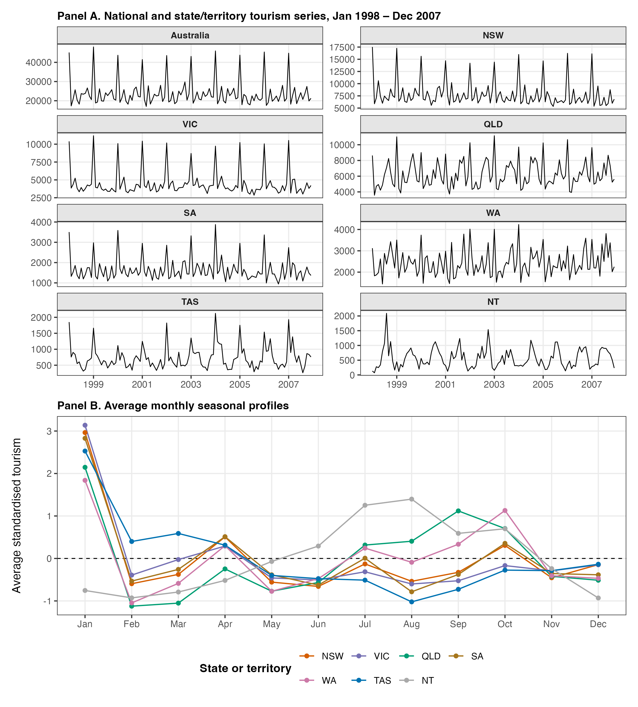
```

```{=latex}
\begin{center}
\begin{minipage}{0.92\linewidth}
\footnotesize\textit{Notes:} Panel A shows the Australian national series and the seven state and territory series over the initial training window, January 1998--December 2007; separate vertical scales are used to make the time-series patterns visible. Panel B shows average month-of-year profiles for the seven state and territory series. Each series is first standardised within the training window by subtracting its sample mean and dividing by its sample standard deviation, after which the standardised observations are averaged by calendar month. NSW = New South Wales; VIC = Victoria; QLD = Queensland; SA = South Australia; WA = Western Australia; TAS = Tasmania; and NT = Northern Territory.
\end{minipage}
\end{center}
```

@fig-d1 presents the national aggregate and seven state and territory series over the initial 120-month training window, January 1998--December 2007. Panel A shows pronounced annual seasonality in many series and substantial differences in their magnitudes. However, their seasonal patterns are not uniform. The average monthly profiles in Panel B, calculated after standardising each state and territory series, show strong January peaks for several states, while the Northern Territory instead experiences relatively high visitor nights during winter, particularly July and August. Thus, the hierarchy exhibits both recurring seasonal movements and differences in seasonal timing across states and territories.[^6]

[^6]: Similar broad seasonal patterns are evident in the middle (January 2004--December 2013) and final (December 2009--November 2019) training windows; see Appendix (@sec-app-a).

```{r}
#| label: tbl-d1
#| echo: false
#| message: false
#| warning: false
#| results: asis
#| tbl-cap: "Component shares and seasonal characteristics of the first five principal components"

d <- readRDS("rds/table_D1_pc_descriptives.rds")

d[[1]] <- tools::toTitleCase(as.character(d[[1]]))
d[[5]] <- tools::toTitleCase(as.character(d[[5]]))

tab_d1 <- d |>
  kableExtra::kbl(
    format = "latex",
    booktabs = TRUE,
    escape = FALSE,
    linesep = "",
    col.names = c(
      "Scaling", "PC", "Share (\\%)", "Seasonal $R^2$ (\\%)",
      "Scaling", "PC", "Share (\\%)", "Seasonal $R^2$ (\\%)"
    ),
    align = c("l", "c", "c", "c", "l", "c", "c", "c")
  ) |>
  kableExtra::add_header_above(
    c("Centred PCA" = 4, "Uncentred PCA" = 4),
    bold = TRUE
  ) |>
  kableExtra::collapse_rows(
    columns = c(1, 5),
    valign = "top",
    latex_hline = "major"
  ) |>
  kableExtra::kable_styling(
    latex_options = "hold_position",
    font_size = 8,
    position = "center"
  )

table_d1_note <- paste0(
  "Entries report the median [2.5th, 97.5th percentiles] across the 144 rolling forecast origins, corresponding to a 95 percent empirical interval. ",
  "Share is the percentage of the total sum of squares associated with each component. For centred PCA, this is the usual percentage of variance explained. ",
  "For uncentred PCA, the reported quantity is a share of total sum of squares, thus does not represent variance explained about the sample mean. ",
  "Seasonal $R^2$ is reported as a percentage and is obtained, at each rolling origin, by regressing the component score on month-of-year indicators."
)

tab_d1_latex <- as.character(tab_d1)
tab_d1_parts <- strsplit(tab_d1_latex, "\\end{table}", fixed = TRUE)[[1]]

cat(
  tab_d1_parts,
  "\\vspace{0.3em}\n",
  "\\parbox{0.96\\linewidth}{\\footnotesize\\textit{Notes:} ",
  table_d1_note,
  "}\n",
  "\\end{table}",
  sep = ""
)

```

@tbl-d1 summarises the first five principal components under all four centring and scaling specifications. For each component, it reports the median and 2.5th and 97.5th percentiles across the 144 rolling training windows of its share of total sum of squares and its seasonal $R^2$, obtained by regressing the component scores on month-of-year indicators. With centred PCA, the share is the usual proportion of variance explained; without centring, it is a share of uncentred sum of squares.

Under centred, unscaled PCA, PC1 explains a median 93.1% of the variation, compared with 3.4% for PC2. Scaling distributes the variation more broadly, reducing these shares to 38.7% and 13.3%, respectively. PC1 is even more dominant without centring, accounting for 99.3% of uncentred sum of squares without scaling and 81.6% with scaling. Thus, scaling reduces concentration in PC1 under both centring treatments, while uncentred PCA assigns a greater share to the first component. Across all four specifications, PC1 and PC2 exhibit strong recurring seasonal patterns, with median seasonal $R^2$ values of approximately 80--94%. Later components generally explain smaller shares and exhibit less pronounced month-of-year patterns, although this varies with preprocessing. These measures describe the component series and do not establish whether their separately generated forecasts provide useful additional predictive information.

@fig-d2 illustrates the first five component scores obtained from centred, unscaled PCA in the initial training window (January 1998--December 2007). Each component score is compared with an illustrative pattern from the observed tourism series. PC1 is compared with the national aggregate. For PC2--PC5, we select the two states or territories with the largest positive loadings and the two with the largest negative loadings. Each selected series is first standardised within the training window. We then average the two standardised series in each group and subtract the negative-loading group's average from the positive-loading group's average. Finally, the resulting contrast and corresponding component score are standardised separately for visual comparison. These patterns provide one possible interpretation of the components and are not exact reconstructions of them, as each component is constructed using the full hierarchy.

```{r}
#| label: fig-d2
#| echo: false
#| message: false
#| warning: false
#| fig-cap: "Illustrative patterns represented by the first five principal components: centred, unscaled PCA"
#| fig-pos: H
#| out-width: "80%"
#| fig-align: center

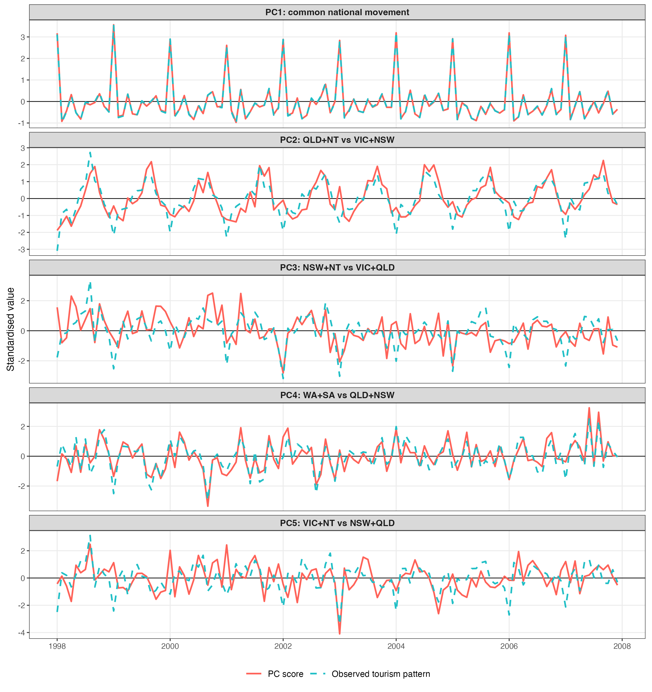
```

```{=latex}
\begin{center}
\begin{minipage}{0.92\linewidth}
\footnotesize\textit{Notes:} Centred, unscaled PCA for January 1998--December 2007. Solid lines show component scores; dashed lines show illustrative tourism patterns. PC1 is compared with the national aggregate, while PC2--PC5 are compared with contrasts between selected state and territory series, constructed as described in the text. All plotted series are standardised for visual comparison. These contrasts are illustrative rather than exact representations of the components.
\end{minipage}
\end{center}
\vspace{1em}
```

In @fig-d2, PC1 closely tracks the national tourism series, reflecting the dominant movement across the hierarchy. PC2 captures a distinct recurring seasonal contrast, illustrated by Queensland and the Northern Territory on one side and Victoria and New South Wales on the other. PCs 3--5 display less regular patterns. The appendix (@sec-app-b) provides the corresponding figures for the middle and final training windows using the same centred, unscaled PCA specification. In these windows, the close correspondence of PC1 with the national series and the broad seasonal contrast represented by PC2 persist. However, the particular state and territory pairs used to illustrate PCs 3--5 differ across windows.

Overall, these descriptive findings show that the principal components capture different features of the hierarchy, including common movements and seasonal differences across states and territories. Whether forecasts of these components provide useful additional information for improving reconciled forecast accuracy is examined in the next section.

## Results and discussion {#sec-results}

In this section, we examine whether, and under which specifications, augmenting IComb with component forecasts improves reconciled forecast accuracy. @tbl-prial-raw-average reports the PRIAL achieved by conventional reconciliation, IComb and FLAIC methods for the overall hierarchy. Results are presented for each forecast horizon ($h=1,\ldots,12$), as well as for the short-term (1–6 months) and long-term (1–12 months) periods defined in @sec-design.[^7] FLAIC achieves negative PRIAL in all but two cases,[^8] indicating that FLAIC-reconciled forecasts generally have higher forecast accuracy relative to the hierarchy base forecasts, although the magnitude of this varies across specifications and horizons.

[^7]: The PRIAL tables for each hierarchy level, in the same format as the Average table, are provided in the Appendix (see @sec-app-c).

[^8]: FLAIC-S under the uncentred and unscaled PCA specification, with $p=77$ and for horizon 12 and FLAIC-L under the uncentred and scaled PCA specification, with $p=77$ and for horizon 11.

In @tbl-prial-raw-average, bold values identify the best-performing method within the ridge and lasso regularisation methods, while underlined values identify the best-performing method overall across all reconciliation methods. FLAIC-L achieves the lowest PRIAL at every individual forecast horizon, although the best-performing FLAIC-L specification varies. For earlier horizons ($h=1$ to $6$), the centred, unscaled PCA specification with low augmentation ($p=3$ or $5$) generally performs best, except at $h=5$, where the uncentred, unscaled specification with $p=20$ achieves the lowest PRIAL. For later horizons ($h=7$ to $12$), the centred, scaled PCA specification with moderate augmentation ($p=10$ or $20$) performs best.

A similar pattern is observed among ridge-based methods. FLAIC-S using centred, unscaled PCA with $p=5$ achieves the lowest PRIAL among ridge methods for horizons 1–6, except at $h=2$, where $p=20$ performs best. For horizons 7–12, the centred, scaled PCA specification with $p=10$ or $20$ performs best.

Considering the short-term and long-term periods, FLAIC-L under centred, unscaled PCA with $p=5$ achieves the lowest PRIAL overall, at −7.03% and −6.67%, respectively. Among ridge-based methods, FLAIC-S under centred, unscaled PCA with $p=5$ performs best in the short term (-6.38%) whereas the centred, scaled specification with $p=10$ performs best over the long-term period (-5.82%) and beats the centred, unscaled specification with $p=5$ by 0.06 percentage points only.

Overall, the best-performing FLAIC variants predominantly use components constructed from centred data. Centred, unscaled PCA tends to perform better at earlier forecast horizons, while centred, scaled PCA is more favourable at later horizons.

Although FLAIC-L achieves the lowest PRIAL overall, this does not necessarily indicate that component augmentation is more effective under lasso regularisation. To illustrate this, for the long-term period, the best FLAIC-L specification achieved a PRIAL which was 0.85 percentage points lower than the PRIAL of the best FLAIC-S specification. However, IComb-L already outperforms IComb-S, with PRIAL values of −6.25% and −4.65%, respectively, over the long-term period (a 1.6 percentage-point difference). Relative to their corresponding IComb benchmarks, the best FLAIC-S and FLAIC-L specifications for the long-term period therefore improved PRIAL by 1.17 and 0.42 percentage points, respectively. We therefore examine $\Delta\text{PRIAL}$, as defined in @eq-delta-prial, to assess the effect of component augmentation relative to the corresponding IComb benchmark across different PCA specifications, numbers of components and forecast horizons.

```{r}
#| label: prial-table-helper
#| echo: false
#| message: false
#| warning: false

library(dplyr)
library(kableExtra)

render_prial_raw <- function(df, digits = 2) {
  value_cols <- c(paste0("h", 1:12), "1-6", "1-12")
  ridge_idx <- df$Family == "Ridge"
  lasso_idx <- df$Family == "Lasso"
  
  for (v in value_cols) {
    x <- df[[v]]
    best_ridge <- min(x[ridge_idx], na.rm = TRUE)
    best_lasso <- min(x[lasso_idx], na.rm = TRUE)
    best_all <- min(x, na.rm = TRUE)
    bold <- (ridge_idx & abs(x - best_ridge) <= 1e-10) | (lasso_idx & abs(x - best_lasso) <= 1e-10)
    underline <- abs(x - best_all) <= 1e-10
    z <- sprintf(paste0("%.", digits, "f"), x)
    z[bold & !underline] <- paste0("\\textbf{", z[bold & !underline], "}")
    z[!bold & underline] <- paste0("\\underline{", z[!bold & underline], "}")
    z[bold & underline] <- paste0("\\underline{\\textbf{", z[bold & underline], "}}")
    df[[v]] <- z
  }
  
  df <- df %>%
    dplyr::group_by(Family, Method, preprocessing) %>%
    dplyr::mutate(Method_show = ifelse(dplyr::row_number() == 1, Method, ""),
                  preprocessing_show = ifelse(dplyr::row_number() == 1, preprocessing, "")) %>%
    dplyr::ungroup()
  
  pack_index <- stats::setNames(rle(df$Family)$lengths, rle(df$Family)$values)
  
  display_df <- df %>%
    dplyr::transmute(Method = Method_show, `PCA preprocessing` = preprocessing_show,
                     `$p$` = ifelse(is.na(p), "", p), dplyr::across(dplyr::all_of(value_cols)))
  
  tab <- display_df %>%
  kbl(format = "latex", booktabs = TRUE, escape = FALSE, linesep = "",
      align = c("l", "l", "c", rep("r", 14)),
      col.names = c("Method", "PCA specification", "$p$", as.character(1:12), "1--6", "1--12")) %>%
  add_header_above(data.frame(header = c("", "Forecast horizon ($h$)"), colspan = c(3, 14)), escape = FALSE) %>%
  pack_rows(index = pack_index, bold = TRUE) %>%
  kable_styling(latex_options = c("HOLD_position", "scale_down"), font_size = 6.5, position = "center")

tab_latex <- as.character(tab)

note <- paste0(
  "Entries report PRIAL (\\%) relative to the ETS base forecasts using raw forecast errors. ",
  "Lower values indicate better forecast performance, and negative values indicate lower MSFE than the base forecasts. ",
  "For each forecast horizon, bold values identify the best method within the Ridge and Lasso families and underlined values identify the best method overall across all reconciliation methods."
)

note_latex <- paste0(
  "\\vspace{0.15em}\n",
  "\\parbox{0.96\\linewidth}{\\scriptsize\\textit{Notes:} ", note, "}\n"
)

tab_parts <- strsplit(tab_latex, "\\end{table}", fixed = TRUE)[[1]]
stopifnot(length(tab_parts) == 1)

cat(
  "\\begingroup\n",
  "\\renewcommand{\\arraystretch}{0.82}\n",
  "\\setlength{\\abovecaptionskip}{3pt}\n",
  "\\setlength{\\belowcaptionskip}{3pt}\n",
  tab_parts,
  "\\vspace{0.10em}\n",
  "\\parbox{0.96\\linewidth}{\\scriptsize\\textit{Notes:} ",
  note,
  "}\n",
  "\\end{table}\n",
  "\\endgroup\n",
  sep = ""
)
}
```

```{r}
#| label: tbl-prial-raw-average
#| echo: false
#| message: false
#| warning: false
#| results: asis
#| tbl-cap: "PRIAL using raw errors: Average"

prial_tables <- readRDS("rds/table_prial_raw_errors.rds")
render_prial_raw(prial_tables$Average)
```

```{r}
#| label: fig-prial-average
#| echo: false
#| fig-cap: "PRIAL of FLAIC relative to IComb: Average"
#| fig-pos: H
#| out-width: "100%"
#| fig-align: center

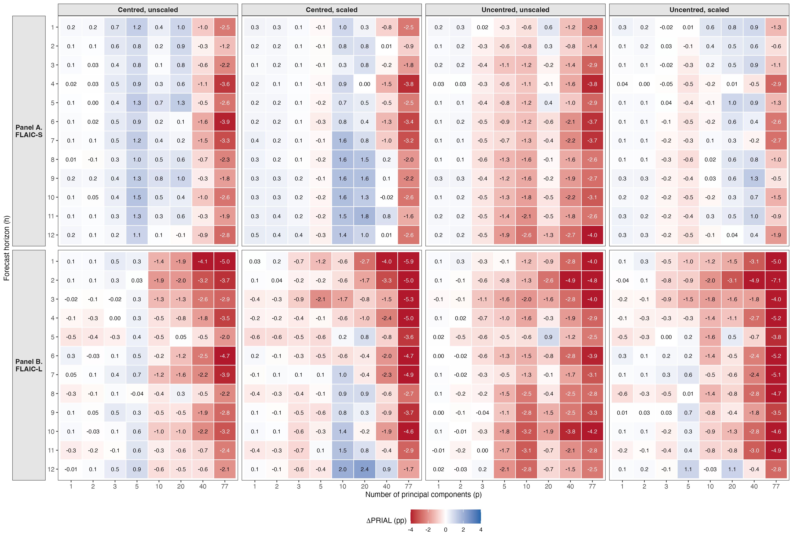
```

```{=latex}
\begin{center}
\begin{minipage}{0.95\linewidth}
\footnotesize\textit{Notes:} Entries report $\Delta$PRIAL in percentage points (pp), defined as PRIAL(IComb) minus PRIAL(FLAIC), so positive values indicate lower MSFE for FLAIC. Panel A compares FLAIC-S with IComb-S, while Panel B compares FLAIC-L with IComb-L. Columns show the four PCA preprocessing specifications.
\end{minipage}
\end{center}
\vspace{1em}
```

@fig-prial-average presents $\Delta\text{PRIAL}$ for the overall hierarchy, comparing FLAIC-S with IComb-S (Panel A) and FLAIC-L with IComb-L (Panel B). The columns distinguish the four PCA centring and scaling specifications, while the rows and horizontal axis represent the 12 forecast horizons and the number of components ($p$), respectively. Positive values indicate that FLAIC achieves lower MSFE than the corresponding IComb benchmark. This allows us to assess the effects of component augmentation across the different FLAIC variants.

First, the effect of component augmentation depends on the number of components introduced. Under ridge regularisation, low and moderate augmentation generally produces improvements relative to IComb-S, particularly for centred PCA specifications. However, the improvement is not monotonic in $p$, and adding more components does not necessarily improve forecast accuracy. At the maximum augmentation dimension ($p=77$), FLAIC performs worse than the corresponding IComb benchmark across all PCA specifications and forecast horizons, under both ridge and lasso regularisation. This deterioration may reflect the introduction of redundant or weak predictive information, alongside the increased number of coefficients to be estimated as more component forecasts are added.

Second, component augmentation is generally more effective under ridge than under lasso regularisation. Positive $\Delta\text{PRIAL}$ values are more widespread for FLAIC-S, whereas FLAIC-L often records negative $\Delta\text{PRIAL}$, indicating poorer forecast accuracy than IComb-L. Nevertheless, there are exceptions. In particular, centred, scaled FLAIC-L with $p=10$ achieves positive $\Delta\text{PRIAL}$ at horizons 7–12, with larger improvements towards the end of the forecast horizon. Thus, the relative advantage of component augmentation under ridge regularisation is not uniform across all configurations and horizons.

Third, the direction of the relative performance difference is often maintained across several forecast horizons for a given PCA specification, augmentation dimension and regularisation method. For instance, under ridge regularisation, centred, unscaled FLAIC-S with $p=5$ and centred, scaled FLAIC-S with $p=10$ improve upon IComb-S at every forecast horizon. However, this pattern does not hold uniformly, for example, centred, scaled FLAIC-L with $p=10$ performs more favourably relative to IComb-L at later horizons than at earlier horizons.

The more frequent improvements under ridge regularisation may be related to how the two estimators handle the additional component forecasts. Ridge retains predictors while shrinking their coefficients, whereas multivariate lasso can exclude predictors by setting their coefficient vectors to zero. As discussed by @zou2005, highly correlated predictors can present difficulties for sparse variable selection, while shrinkage methods offer an alternative way to combine overlapping signals. Similarly, @nguyen2025a suggest that relatively dense models can be advantageous when useful predictive information is distributed across many weak signals. These arguments offer a possible explanation for our findings as well, since the separately generated component forecasts need not be uncorrelated with the hierarchy base forecasts. However, they do not establish why ridge-based augmentation performs more favourably in this application. We examine the component forecasts retained by FLAIC-L later in this section to investigate how the additional predictors are used.

The preceding analysis considers the overall forecast accuracy difference between FLAIC and IComb, summarised by $\Delta\text{PRIAL}$. However, as shown in @eq-msfe-empirical, MSFE averages squared forecast errors across both the hierarchy series and rolling forecast origins. Consequently, differences in PRIAL may reflect varying forecast performance across series, origins, or both. We examine these two dimensions separately, beginning with the rolling forecast origins. In particular, we consider how frequently FLAIC achieves lower average squared forecast loss than IComb at individual origins, and the magnitude of these differences.

```{r}
#| label: fig-origin-wins-average
#| echo: false
#| fig-cap: "Forecast origin-level FLAIC performance relative to IComb: Average"
#| fig-pos: H
#| out-width: "100%"
#| fig-align: center

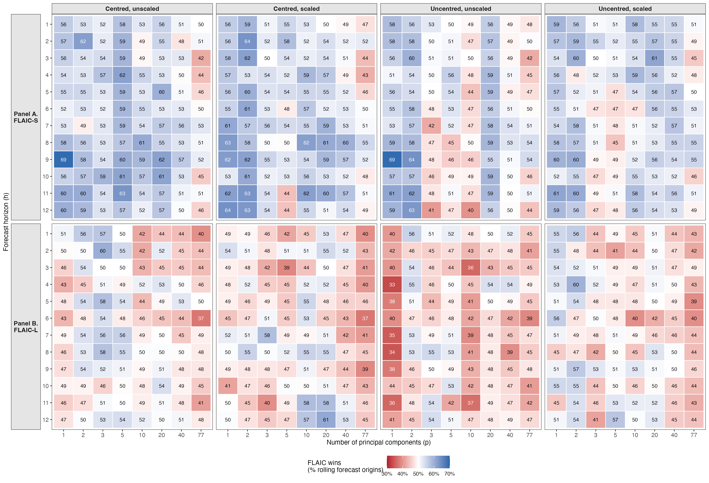
```

```{=latex}
\begin{center}
\begin{minipage}{0.95\linewidth}
\footnotesize\textit{Notes:} Entries report the percentage of rolling forecast origins at which FLAIC has lower squared-error loss (when averaged across all 112 hierarchy series) than its matched IComb reconciliation method. Values above 50\% indicate that FLAIC performs better at a majority of origins. Panel A compares FLAIC-S with IComb-S, while Panel B compares FLAIC-L with IComb-L.
\end{minipage}
\end{center}
\vspace{1em}
```

@fig-origin-wins-average reports the percentage of rolling forecast origins at which FLAIC achieves lower average squared forecast loss across the 112 hierarchy series than its corresponding IComb benchmark. The heatmap follows the same arrangement of PCA specifications, augmentation dimensions and forecast horizons as @fig-prial-average. A value above 50% indicates that FLAIC outperforms IComb at a majority of evaluable forecast origins for that specification.

Comparing @fig-origin-wins-average with @fig-prial-average, we generally observe that configurations with positive $\Delta\text{PRIAL}$ also tend to have FLAIC outperforming IComb at a majority of forecast origins. Consistent with the earlier results, FLAIC-S achieves this more frequently than FLAIC-L, particularly at low and moderate augmentation dimensions.

For illustration purposes only, to demonstrate the relationship between these two measures, we count the configurations for which the direction of $\Delta\text{PRIAL}$ agrees with the majority of origin-level outcomes. Across the 384 configurations considered for each regularisation method,[^9] agreement occurs in 285 cases (74.2%) under ridge and 257 cases (66.9%) under lasso. However, disagreement occurs in 90 ridge and 114 lasso cases. Most of these disagreements arise when FLAIC achieves lower average squared loss at a majority of origins but nevertheless has a negative $\Delta\text{PRIAL}$, occurring in 87 ridge and 75 lasso cases. This illustrates that the frequency of improvements does not necessarily determine the overall forecast accuracy difference, which also depends on the magnitude of improvements and deterioration experienced across origins.

[^9]: For each regularisation method, the 384 configurations comprise 4 PCA specifications, 8 values of $p$ and 12 forecast horizons. 9 ridge and 13 lasso configurations are classified as boundary cases because each case had equal number of forecast origins where FLAIC had beaten IComb and vice versa. These cases were excluded from the agreement and disagreement categories. These counts are descriptive, as the configurations involve overlapping component sets, forecast origins and horizons, and should not be interpreted as independent observations.

To investigate this further, @fig-origin-contribution-selected illustrates the distribution of the origin-level normalised loss difference, $q_{\tau,h}$, defined in @eq-origin-prial, for two cases. As shown in @eq-origin-prial-decomp, the mean of $q_{\tau,h}$ equals $\Delta\text{PRIAL}$, allowing us to examine how differences in magnitude across origins contribute to the overall forecast accuracy difference.

```{r}
#| label: fig-origin-contribution-selected
#| echo: false
#| fig-cap: "Distribution of forecast origin-level normalised loss differences between FLAIC and IComb"
#| fig-pos: H
#| out-width: "100%"
#| fig-align: center

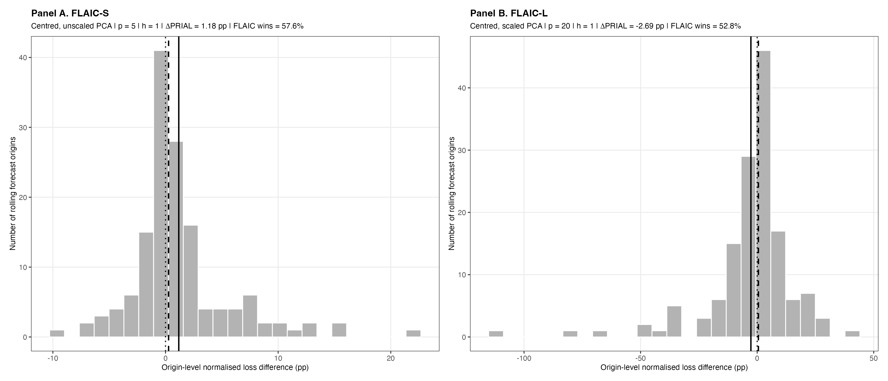
```

```{=latex}
\begin{center}
\begin{minipage}{0.92\linewidth}
\footnotesize\textit{Notes:} Histograms show the distribution of $q_{\tau,h}$, defined in \eqref{eq-origin-prial}, across rolling forecast origins. Positive values favour FLAIC, and the mean equals $\Delta\text{PRIAL}$. Solid and dashed vertical lines indicate the mean and median, respectively; the dotted line indicates zero. Panel A illustrates agreement between the majority of origin-level outcomes and overall $\Delta\text{PRIAL}$, while Panel B illustrates disagreement.
\end{minipage}
\end{center}
\vspace{1em}
```

The two cases illustrated are at the one-month forecast horizon. Panel A considers FLAIC-S under centred, unscaled PCA with $p=5$, which improves upon IComb-S at 57.6% of forecast origins and achieves a positive $\Delta\text{PRIAL}$ of 1.18 percentage points. Panel B considers FLAIC-L under centred, scaled PCA with $p=20$. Although this specification achieves lower loss than IComb-L at 52.8% of forecast origins, its overall $\Delta\text{PRIAL}$ is negative (−2.69 percentage points). The distribution in Panel B shows that relatively large deteriorations at some origins outweigh the improvements achieved at others. Thus, a higher frequency of favourable outcomes does not necessarily translate into improved overall forecast accuracy when the magnitudes of the loss differences are taken into account.

We next examine how the effect of component augmentation varies across hierarchy levels, which is the other dimension underlying the MSFE calculation (@eq-msfe-empirical). @fig-prial-hierarchy presents $\Delta\text{PRIAL}$ separately for Australia, States, Zones and Regions under centred, unscaled PCA, with Panel A comparing FLAIC-S with IComb-S and Panel B comparing FLAIC-L with IComb-L. The corresponding heatmaps for the other three PCA specifications are provided in the Appendix (see @sec-app-d), with the PRIAL results for each hierarchy level reported in @sec-app-c.

```{r}
#| label: fig-prial-hierarchy
#| echo: false
#| fig-cap: "PRIAL of FLAIC relative to matching IComb by hierarchy level: Centred, unscaled PCA"
#| fig-pos: H
#| out-width: "100%"
#| fig-align: center

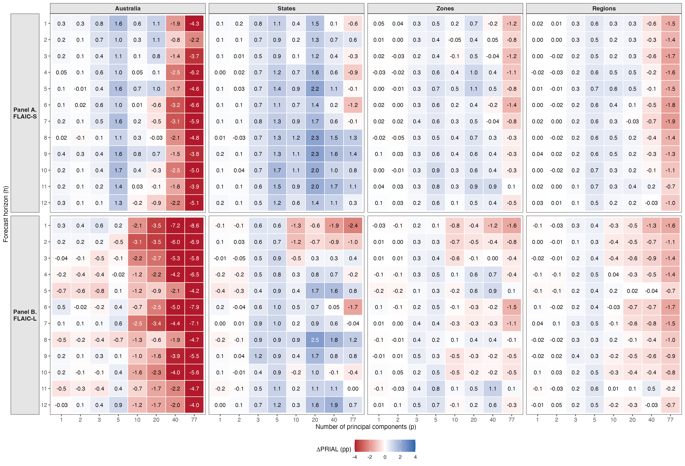
```

```{=latex}
\begin{center}
\begin{minipage}{0.90\linewidth}
\footnotesize\textit{Notes:} Entries report $\Delta$PRIAL in percentage points, defined as PRIAL(IComb) minus PRIAL(FLAIC), so positive values indicate lower MSFE for FLAIC. Panel A compares FLAIC-S with IComb-S, while Panel B compares FLAIC-L with IComb-L. Columns report results for Australia, States, Zones and Regions.
\end{minipage}
\end{center}
\vspace{0.8em}
```

The results reveal differences in the effects of component augmentation across hierarchy levels. Under ridge regularisation, improvements relative to IComb-S are more widespread at the state level, particularly for low and moderate augmentation. Zones and Regions also exhibit improvements for certain specifications, although these are generally smaller in magnitude. In contrast, the national aggregate exhibits a particularly pronounced deterioration as the number of components increases. At $p=77$, FLAIC performs worse than the corresponding IComb benchmark for the Australia series at every forecast horizon under both regularisation methods and all four PCA specifications. While higher augmentation dimensions also tend to weaken performance at the other levels, the deterioration is less uniform, with some state-level ridge specifications continuing to improve upon IComb-S.

The PRIAL results in @sec-app-c further show that the best-performing FLAIC variants differ across hierarchy levels. For Regions, FLAIC-S under centred, unscaled PCA with $p=5$ achieves the lowest PRIAL across all individual forecast horizons, as well as over the short-term and long-term periods. For Australia, the lowest PRIAL is generally achieved by FLAIC-L, although the preferred PCA specification and number of components vary across horizons. For States and Zones, FLAIC-S under centred, unscaled PCA with $p=20$ performs best over both the short-term and long-term periods, while FLAIC-L achieves the lowest PRIAL at some individual horizons. Overall, these findings indicate that the relative effectiveness of component augmentation, as well as the preferred degree of augmentation and regularisation method, differs across hierarchy levels.

The preceding analyses compare the forecast performance of FLAIC and IComb using MSFE and PRIAL, but do not establish whether the differences in forecast accuracy are statistically significant. We therefore consider the Friedman and post-hoc Nemenyi tests, visualised through Multiple Comparisons with the Best (MCB) plots, as described in @sec-design.[^10] @fig-mcb-centred-unscaled presents the results for centred, unscaled PCA at forecast horizons $h=1,6,12$, comparing IComb with the eight corresponding FLAIC variants separately for ridge (Panel A) and lasso (Panel B). The plots report average ranks across the 112 hierarchy series, where a lower rank indicates better relative forecast performance. Methods that are significantly worse than the best-ranked method are identified using the 5% Nemenyi critical distance. The corresponding plots for the other three PCA specifications are provided in the Appendix (see @sec-app-e).

[^10]: Supplementary MCB comparisons that include the ETS base forecasts are available at <https://github.com/branesh97/flaic-honours-thesis>. Both IComb variants and all FLAIC variants are significantly better-ranked than the base forecasts at $h=1$ and $h=12$. At $h=6$, the same holds except for two ridge-based FLAIC variants with $p=77$, under centred, unscaled and uncentred, unscaled PCA. These comparisons include the base forecasts as an additional method and therefore use a separate Nemenyi critical distance.

```{r}
#| label: fig-mcb-centred-unscaled
#| echo: false
#| fig-cap: "Multiple comparisons with the best for FLAIC"
#| fig-pos: H
#| out-width: "100%"
#| fig-align: center

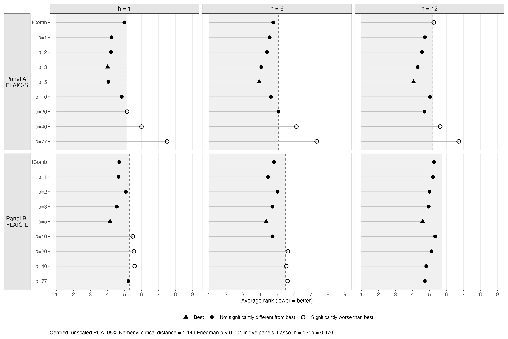
```

Under centred, unscaled PCA, the best average ranks are generally achieved with low component augmentation. For ridge regularisation, FLAIC-S with $p=3$ is best-ranked at $h=1$, while $p=5$ is best-ranked at $h=6$ and $h=12$. Under lasso regularisation, FLAIC-L with $p=5$ achieves the lowest average rank at all three horizons. However, several other FLAIC variants with relatively few components are not significantly worse than these best-ranked specifications, indicating that the MCB results do not identify a uniquely superior augmentation dimension.

More importantly, the evidence that component augmentation significantly improves forecast accuracy relative to IComb is limited. Under ridge regularisation, IComb-S is not significantly worse than the best-ranked FLAIC-S specification at $h=1$ and $h=6$, although it is significantly worse at $h=12$.[^11] Under lasso regularisation, IComb-L is not significantly worse than the best-ranked FLAIC-L specification at any of the three horizons. The Friedman test also does not reject equal average ranks across the lasso-based methods at $h=12$ ($p=0.476$). The alternative PCA specifications in @sec-app-e show some additional cases of statistically significant improvement. In particular, at $h=1$, IComb-S is significantly worse than the best-ranked FLAIC-S variant ($p=2$) under both uncentred PCA specifications, despite relatively small improvements in $\Delta\text{PRIAL}$ of approximately 0.2–0.3 percentage points. However, statistical evidence in favour of component augmentation is not consistent across PCA specifications, regularisation methods and forecast horizons.

[^11]: Since the reconciliation coefficients are estimated using one-step-ahead forecasts and subsequently applied to longer horizons, the results at $h=1$ are particularly informative as a benchmark. For centred, unscaled PCA, neither IComb-S nor IComb-L is significantly worse than the best-ranked corresponding FLAIC variant at this horizon.

In contrast, the adverse effect of high component augmentation is more evident, particularly under ridge regularisation. For both $p=40$ and $p=77$, FLAIC-S is significantly worse than the best-ranked method at all three horizons under each of the four PCA specifications. This is consistent with the deterioration in $\Delta\text{PRIAL}$ observed at higher augmentation dimensions and indicates that the poorer performance extends across the series-level rankings used in the MCB comparisons. Under lasso regularisation, the statistical evidence against high augmentation is less uniform, with some high-dimensional specifications remaining statistically indistinguishable from the best-ranked method. Overall, the MCB results provide limited evidence of systematic forecast accuracy improvements from component augmentation, while showing clearer evidence of deterioration when many components are added, especially under ridge regularisation.

The MCB results provide limited evidence that component augmentation consistently improves forecast accuracy relative to IComb, particularly under lasso regularisation. To investigate how the additional component forecasts are used, we examine predictor selection in FLAIC-L. Since multivariate lasso can set entire predictor coefficient vectors to zero, we can assess whether the component forecasts are retained and whether their inclusion is accompanied by the exclusion of hierarchy base forecasts that would otherwise be retained by IComb-L.

@tbl-r2 reports the median number of component forecasts retained by FLAIC-L and the difference in the number of hierarchy base forecasts retained between FLAIC-L and IComb-L, across the 144 rolling forecast origins. At low augmentation ($p=1$ or $2$), the median number of component forecasts retained is zero across all PCA specifications. As $p$ increases, however, FLAIC-L retains a substantial proportion of the additional component forecasts. For example, at $p=20$, a median of 15–16 component forecasts are retained, while FLAIC-L retains only 2–2.5 fewer hierarchy base forecasts than IComb-L. Even at $p=77$, approximately 39–42 component forecasts are retained, compared with a reduction of only 5–6 hierarchy base forecasts. Thus, the inclusion of component forecasts is generally not accompanied by a comparable reduction in the number of retained hierarchy base forecasts.

```{r}
#| label: tbl-r2
#| echo: false
#| results: asis
#| message: false
#| warning: false
#| tbl-cap: "Lasso predictor selection"

library(dplyr)
library(kableExtra)

df <- readRDS("rds/table_R2_lasso_predictor_selection.rds")
meta <- readRDS("rds/table_R2_lasso_predictor_selection_meta.rds")

display_df <- df %>%
  transmute(
    p = p,
    H1 = `Centred, unscaled__Delta hierarchy retained`,
    PC1 = `Centred, unscaled__PC forecasts retained`,
    H2 = `Centred, scaled__Delta hierarchy retained`,
    PC2 = `Centred, scaled__PC forecasts retained`,
    H3 = `Uncentred, unscaled__Delta hierarchy retained`,
    PC3 = `Uncentred, unscaled__PC forecasts retained`,
    H4 = `Uncentred, scaled__Delta hierarchy retained`,
    PC4 = `Uncentred, scaled__PC forecasts retained`
  )

tab_r2 <- display_df %>%
  kbl(
    format = "latex",
    booktabs = TRUE,
    escape = FALSE,
    linesep = "",
    align = c("c", rep("r", 8)),
    col.names = c(
      "$p$",
      "\\shortstack{$\\Delta$ hierarchy\\\\retained}",
      "\\shortstack{PC forecasts\\\\retained}",
      "\\shortstack{$\\Delta$ hierarchy\\\\retained}",
      "\\shortstack{PC forecasts\\\\retained}",
      "\\shortstack{$\\Delta$ hierarchy\\\\retained}",
      "\\shortstack{PC forecasts\\\\retained}",
      "\\shortstack{$\\Delta$ hierarchy\\\\retained}",
      "\\shortstack{PC forecasts\\\\retained}"
    )
  ) %>%
  add_header_above(
    c(
      " " = 1,
      "Centred, unscaled" = 2,
      "Centred, scaled" = 2,
      "Uncentred, unscaled" = 2,
      "Uncentred, scaled" = 2
    ),
    escape = FALSE
  ) %>%
  kable_styling(
    latex_options = c("HOLD_position", "scale_down"),
    font_size = 8,
    position = "center"
  )

table_r2_note <- paste0(
  "Entries are medians across the 144 rolling forecast origins. ",
  "$\\Delta$ hierarchy retained is the number of hierarchy forecast predictors retained by FLAIC-L minus the number retained by IComb-L; negative values therefore indicate that FLAIC-L retains fewer hierarchy predictors. ",
  "PC forecasts retained reports the number of the $p$ candidate PC forecast predictors retained, with the percentage retained in parentheses. ",
  "IComb-L retains a median of ", meta$icomb_retained_median, " of the ", meta$hierarchy_total, " hierarchy forecast predictors across origins. ",
  "A predictor is classified as retained when its coefficient vector across the 112 response equations contains at least one non-zero coefficient."
)

tab_r2_latex <- as.character(tab_r2)
tab_r2_parts <- strsplit(tab_r2_latex, "\\end{table}", fixed = TRUE)[[1]]

cat(
  tab_r2_parts,
  "\\vspace{0.3em}\n",
  "\\parbox{0.96\\linewidth}{\\footnotesize\\textit{Notes:} ",
  table_r2_note,
  "}\n",
  "\\end{table}",
  sep = ""
)

```

To examine which component forecasts are selected, @fig-pc-retention-p20 shows their retention frequencies for $p=20$ across all four PCA specifications. We consider this moderate augmentation dimension because it allows us to examine selection patterns across both leading and higher-order components, while its forecast accuracy results vary across specifications and horizons. PC1 and PC2 are rarely retained, whereas forecasts of PC3–PC20 are frequently retained across rolling forecast origins. This pattern is broadly consistent across PCA specifications. Although PCA orders components according to their associated eigenvalues, this ordering does not necessarily reflect their usefulness as regression predictors. As discussed by @jolliffe1982, components associated with smaller eigenvalues may still be relevant in regression. In our application, the frequent retention of higher-order component forecasts indicates that FLAIC-L assigns non-zero coefficients to these additional predictors, but this does not necessarily imply that their inclusion improves out-of-sample forecast accuracy.

```{r}
#| label: fig-pc-retention-p20
#| echo: false
#| message: false
#| warning: false
#| fig-cap: 'Retention of principal-component forecasts by FLAIC-L at $p=20$'
#| fig-pos: H
#| out-width: "100%"
#| fig-align: center

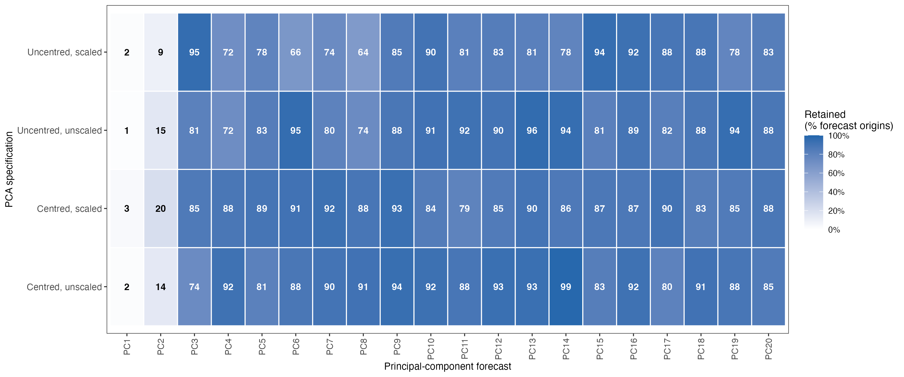
```

```{=latex}
\begin{center}
\begin{minipage}{0.90\linewidth}
\footnotesize\textit{Notes:} Entries report the percentage of 144 rolling forecast origins at which each principal-component forecast is retained by FLAIC-L, where retention indicates a non-zero coefficient vector across the 112 response equations. Results are shown for $p=20$ under all four PCA preprocessing specifications.
\end{minipage}
\end{center}
\vspace{1em}
```

Taken together, these findings indicate that FLAIC-L frequently retains additional component forecasts without a comparable reduction in the number of hierarchy base forecasts retained. However, the earlier $\Delta\text{PRIAL}$ results show that these selections do not consistently translate into improvements in out-of-sample forecast accuracy. This may reflect limited additional predictive information from the retained component forecasts or the effects of estimating a larger set of coefficients. The selection results alone do not establish which explanation is responsible.

We next examine whether the effect of component augmentation depends on the method used to combine the forecasts. For this purpose, we consider the hierarchy-adapted FLAP benchmark introduced in @sec-flap_hts, which uses the same hierarchy base forecasts and component forecasts as FLAIC, but combines them through a forecast-error-covariance-based oblique projection rather than the IComb regression framework. This allows us to compare the effect of adding component forecasts to MinT with their effect when introduced through IComb.

@tbl-r4 reports the PRIAL achieved by FLAP for the overall hierarchy across PCA specifications, augmentation dimensions and selected forecast horizons. We find that FLAP generally achieves lower PRIAL as the number of components increases from low to moderate or high augmentation, although the improvement is not monotonic. In particular, $p=40$ achieves the lowest PRIAL over the long-term period (1–12 months) within each of the four PCA specifications. The best overall FLAP result for this period is obtained under centred, scaled PCA with $p=40$, yielding a PRIAL of −1.12%. Nevertheless, FLAP's PRIAL remains positive in most cases, indicating that its reconciled forecasts generally do not outperform the original hierarchy base forecasts.

```{r}
#| label: tbl-r4
#| echo: false
#| results: asis
#| message: false
#| warning: false
#| tbl-cap: "FLAP forecast performance: Average"
#| tbl-pos: H

library(dplyr)
library(kableExtra)

df <- readRDS("rds/table_R4_flap_prial_average.rds")

value_cols <- c("h1", "h6", "h12", "h16", "h112")

# Lower PRIAL = better.
# Bold = best p within each PCA preprocessing specification.
# Underline = best FLAP result overall for each horizon.

for (v in value_cols) {
  x <- df[[v]]
  z <- sprintf("%.2f", x)

  for (cs_i in unique(df$CS)) {
    idx <- df$CS == cs_i
    best <- min(x[idx], na.rm = TRUE)
    hit <- idx & abs(x - best) <= 1e-10
    z[hit] <- paste0("\\textbf{", z[hit], "}")
  }

  best_all <- min(x, na.rm = TRUE)
  hit <- abs(x - best_all) <= 1e-10
  z[hit] <- paste0("\\underline{", z[hit], "}")

  df[[paste0(v, "_fmt")]] <- z
}

# Centred PCA on left; uncentred PCA on right.
centred <- df %>%
  filter(center == TRUE) %>%
  mutate(p_num = as.integer(p)) %>%
  arrange(scale, p_num)

uncentred <- df %>%
  filter(center == FALSE) %>%
  mutate(p_num = as.integer(p)) %>%
  arrange(scale, p_num)

stopifnot(nrow(centred) == nrow(uncentred))
stopifnot(identical(centred$scale, uncentred$scale))
stopifnot(identical(centred$p_num, uncentred$p_num))

# Show scaling label once at the beginning of each block.
centred_scale <- ifelse(
  duplicated(centred$scale), "",
  ifelse(centred$scale, "Scaled", "Unscaled")
)

uncentred_scale <- ifelse(
  duplicated(uncentred$scale), "",
  ifelse(uncentred$scale, "Scaled", "Unscaled")
)

display_df <- tibble::tibble(
  C_scale = centred_scale,
  C_p = centred$p,
  C_h1 = centred$h1_fmt,
  C_h6 = centred$h6_fmt,
  C_h12 = centred$h12_fmt,
  C_h16 = centred$h16_fmt,
  C_h112 = centred$h112_fmt,

  U_scale = uncentred_scale,
  U_p = uncentred$p,
  U_h1 = uncentred$h1_fmt,
  U_h6 = uncentred$h6_fmt,
  U_h12 = uncentred$h12_fmt,
  U_h16 = uncentred$h16_fmt,
  U_h112 = uncentred$h112_fmt
)

tab_r4 <- display_df %>%
  kbl(
    format = "latex",
    booktabs = TRUE,
    escape = FALSE,
    linesep = "",
    align = c("l", "c", rep("r", 5), "l", "c", rep("r", 5)),
    col.names = c(
      "Scaling", "$p$", "1", "6", "12", "1--6", "1--12",
      "Scaling", "$p$", "1", "6", "12", "1--6", "1--12"
    )
  ) %>%
  add_header_above(
    c(
      " " = 2,
      "Forecast horizon ($h$)" = 5,
      " " = 2,
      "Forecast horizon ($h$)" = 5
    ),
    bold = FALSE,
    escape = FALSE
  ) %>%
  add_header_above(
    c(
      "Panel A. Centred PCA" = 7,
      "Panel B. Uncentred PCA" = 7
    ),
    bold = TRUE,
    escape = FALSE
  ) %>%
  column_spec(c(1, 8), bold = TRUE) %>%
  kable_styling(
    latex_options = c("scale_down"),
    font_size = 8,
    position = "center"
  )

table_r4_note <- paste0(
  "Entries report FLAP PRIAL (%) relative to the ETS base forecasts. ",
  "Lower values indicate better forecast performance, with negative values indicating lower MSFE than the base forecasts. ",
  "Columns 1--6 and 1--12 report results for the short-term and long-term periods, respectively. ",
  "Bold values identify the lowest PRIAL within each PCA specification, while underlined values identify the lowest PRIAL overall for each forecast horizon or period."
)

tab_r4 <- tab_r4 %>%
  kableExtra::footnote(
    general = table_r4_note,
    general_title = "Notes: ",
    threeparttable = TRUE,
    footnote_as_chunk = TRUE,
    escape = TRUE
  )

cat(as.character(tab_r4))

```

@tbl-r5 provides a direct comparison of FLAP with MinT$_{shr}$, FLAIC-S and FLAIC-L. Panel A shows that FLAP achieves lower MSFE than MinT$_{shr}$ across all reported PCA specifications, augmentation dimensions and forecast horizons. For example, over the long-term period, centred, scaled FLAP with $p=40$ improves PRIAL by 5.89 percentage points relative to MinT$_{shr}$. Thus, component augmentation through the FLAP projection consistently improves upon the corresponding MinT benchmark in the comparisons considered. However, Panels B and C show that both FLAIC-S and FLAIC-L achieve lower MSFE than the matching FLAP specifications in every reported comparison.

```{r}
#| label: tbl-r5
#| echo: false
#| results: asis
#| message: false
#| warning: false
#| tbl-cap: "Comparison of FLAP with MinT, FLAIC-S and FLAIC-L: Average"
#| tbl-pos: H

library(dplyr)
library(kableExtra)

df <- readRDS("rds/table_R5_flap_method_comparison.rds")

keys <- c("h1", "h6", "h12", "h16", "h112")

pca_order <- c(
  "Centred, unscaled",
  "Centred, scaled",
  "Uncentred, unscaled",
  "Uncentred, scaled"
)

# Convert old C/S labels to the final terminology.
df <- df %>%
  mutate(
    PCA = case_when(
      CS == "C=T, S=F" ~ "Centred, unscaled",
      CS == "C=T, S=T" ~ "Centred, scaled",
      CS == "C=F, S=F" ~ "Uncentred, unscaled",
      CS == "C=F, S=T" ~ "Uncentred, scaled",
      TRUE ~ as.character(CS)
    ),
    PCA = factor(PCA, levels = pca_order),
    p_num = as.integer(p)
  ) %>%
  arrange(PCA, p_num)

# Panel A: MinT_shr - FLAP
# Panel B: FLAP - FLAIC-S
# Panel C: FLAP - FLAIC-L
# Positive values favour FLAP in Panel A and FLAIC in Panels B/C.
# Bold = largest favourable difference within each PCA specification.
# Underline = largest favourable difference overall for each horizon.

for (panel in c("A", "B", "C")) {
  for (key in keys) {
    col <- paste0(panel, "__", key)
    x <- df[[col]]
    z <- sprintf("%.2f", x)

    for (pca_i in levels(df$PCA)) {
      idx <- df$PCA == pca_i
      best <- max(x[idx], na.rm = TRUE)
      hit <- idx & abs(x - best) <= 1e-10
      z[hit] <- paste0("\\textbf{", z[hit], "}")
    }

    best_all <- max(x, na.rm = TRUE)
    hit <- abs(x - best_all) <= 1e-10
    z[hit] <- paste0("\\underline{", z[hit], "}")

    df[[paste0(col, "_fmt")]] <- z
  }
}

display_df <- tibble::tibble(
  `$p$` = df$p,

  A1 = df$A__h1_fmt,
  A6 = df$A__h6_fmt,
  A12 = df$A__h12_fmt,
  A16 = df$A__h16_fmt,
  A112 = df$A__h112_fmt,

  B1 = df$B__h1_fmt,
  B6 = df$B__h6_fmt,
  B12 = df$B__h12_fmt,
  B16 = df$B__h16_fmt,
  B112 = df$B__h112_fmt,

  C1 = df$C__h1_fmt,
  C6 = df$C__h6_fmt,
  C12 = df$C__h12_fmt,
  C16 = df$C__h16_fmt,
  C112 = df$C__h112_fmt
)

pca_rle <- rle(as.character(df$PCA))
pca_index <- stats::setNames(pca_rle$lengths, pca_rle$values)

tab_r5 <- display_df %>%
  kbl(
    format = "latex",
    booktabs = TRUE,
    escape = FALSE,
    linesep = "",
    align = c("c", rep("r", 15)),
    col.names = c(
      "$p$",
      rep(c("1", "6", "12", "1--6", "1--12"), 3)
    )
  ) %>%
  # This row sits BELOW the panel headings because it is added first.
  add_header_above(
    c(
      " " = 1,
      "Forecast horizon ($h$)" = 15
    ),
    bold = FALSE,
    escape = FALSE
  ) %>%
  # Added second, therefore this becomes the TOP header row.
  add_header_above(
    c(
      " " = 1,
      "Panel A. MinT$_{shr}$ $-$ FLAP (pp)" = 5,
      "Panel B. FLAP $-$ FLAIC-S (pp)" = 5,
      "Panel C. FLAP $-$ FLAIC-L (pp)" = 5
    ),
    bold = TRUE,
    escape = FALSE
  ) %>%
  pack_rows(index = pca_index, bold = TRUE) %>%
  kable_styling(
    latex_options = c("scale_down"),
    font_size = 7.5,
    position = "center"
  )


table_r5_note <- paste0(
  "Entries report differences in PRIAL, measured in percentage points. ",
  "Panel A reports PRIAL(MinT$_{shr}$) $-$ PRIAL(FLAP), so positive values favour FLAP. ",
  "Panels B and C report PRIAL(FLAP) $-$ PRIAL(FLAIC-S) and PRIAL(FLAP) $-$ PRIAL(FLAIC-L), respectively, so positive values favour the corresponding FLAIC method. ",
  "FLAP and FLAIC are matched by PCA specification, number of components and forecast horizon. ",
  "Columns 1--6 and 1--12 report results for the short-term and long-term periods, respectively. ",
  "Bold values identify the largest favourable difference within each PCA specification, while underlined values identify the largest favourable difference overall for each forecast horizon or period."
)

tab_r5 <- tab_r5 %>%
  kableExtra::footnote(
    general = table_r5_note,
    general_title = "Notes: ",
    threeparttable = TRUE,
    footnote_as_chunk = TRUE,
    escape = FALSE
  )

cat(as.character(tab_r5))

```

These findings reveal an important distinction between the two approaches to component augmentation. Although FLAP consistently improves upon MinT$_{shr}$ in our empirical comparisons, the earlier $\Delta\text{PRIAL}$ results show that FLAIC does not consistently improve upon IComb. Moreover, FLAP tends to perform more favourably with moderate to high augmentation, while FLAIC often deteriorates as the number of components becomes large. These differences suggest that the forecasting effect of component augmentation depends on how the additional forecasts are incorporated. They also reflect differences between the original MinT and IComb benchmarks, with IComb already achieving substantially better forecast accuracy in this application. Hence, improvements from adding component forecasts under the FLAP projection do not necessarily imply corresponding improvements when the same forecasts are introduced through the IComb regression framework.

Finally, we assess the robustness of our findings to differences in scale across hierarchy series by evaluating forecast accuracy using seasonal-naïve-scaled and variance-standardised squared forecast errors, as defined in @sec-design. Under the raw-error MSFE, series which have values that are of relatively larger scale, such as the national and state aggregates, may contribute more to the overall loss than series at lower hierarchy levels. The alternative measures adjust for such differences in scale when computing the mean squared forecast error. Notably, the forecasts themselves remain unchanged, while only the loss used to calculate MSFE and PRIAL is adjusted.

The results for the overall hierarchy are reported in the Appendix (see @sec-app-f). Under both alternative measures, low and moderate component augmentation can still improve forecast accuracy relative to IComb, particularly for centred PCA specifications. However, the improvements in $\Delta\text{PRIAL}$ are generally smaller than those obtained using raw squared errors. High augmentation, particularly at $p=77$, continues to deteriorate forecast accuracy relative to IComb across PCA specifications and regularisation methods. Thus, the key finding that component augmentation can improve forecast accuracy under certain specifications, but that introducing many components is generally detrimental, remains evident under both alternative measures.

An important difference concerns the relative performance of ridge and lasso regularisation. While FLAIC-L achieves the lowest PRIAL under raw squared errors, FLAIC-S performs best under both scaled-error measures. Over the long-term period, centred, unscaled FLAIC-S with $p=5$ achieves the lowest PRIAL of −9.66% using seasonal-naïve-scaled errors and −10.35% using variance-standardised errors, compared with −9.39% and −10.18% for IComb-S, respectively. These correspond to improvements of 0.27 and 0.17 percentage points relative to IComb-S. The change in the best-performing regularisation method indicates that the relative forecast performance of ridge and lasso is sensitive to how squared forecast errors are weighted across hierarchy series.[^12]

[^12]: The sensitivity to the forecast-error measure is also evident for MinT$_{shr}$. Over horizons 1–12, its PRIAL changes from 4.77% under raw squared errors to −1.96% and −2.05% under seasonal-naïve-scaled and variance-standardised squared errors, respectively.

# Conclusion {#sec-conclude}

This thesis investigated whether forecasts of constructed linear components can improve the accuracy of hierarchical forecasts when incorporated into the Information Combination (IComb) framework. Motivated by the Forecast Linear Augmented Projection (FLAP) approach of @yang2024a and the IComb framework of @nguyen2025a, we proposed Forecasting with Linear Augmented Information Combination (FLAIC). The method augments the hierarchy base forecasts used in IComb with separately generated forecasts of principal components constructed from the hierarchy series. Although these components are constructed from existing observations and introduce no new underlying data, forecasting them separately may capture predictable movements that are not fully reflected in the hierarchy base forecasts. This may be particularly useful when certain linear combinations exhibit more forecastable dynamics than the individual series. Whether these component forecasts provide useful additional predictive information is therefore an empirical question. We considered ridge (FLAIC-S) and multivariate lasso (FLAIC-L) regularisation to estimate the expanded regression model in the IComb framework while maintaining coherence. We also developed a hierarchy-adapted FLAP benchmark, which incorporates both the hierarchy aggregation constraints and component relationships through a forecast-error-covariance-based oblique projection. Since this formulation reduces to MinT when no components are added, it provides a comparison of component augmentation under covariance-based reconciliation and the IComb regression framework.

We evaluated FLAIC using a hierarchy of 112 Australian domestic tourism series, considering four PCA centring and scaling specifications, different numbers of components and forecast horizons of 1–12 months. The results show that FLAIC generally improves forecast accuracy relative to the original ETS base forecasts and conventional reconciliation methods. Under raw squared forecast errors, FLAIC-L achieves the lowest PRIAL among the methods considered, although the best-performing FLAIC-S specifications also perform favourably. Over horizons 1–12, the best FLAIC-L specification achieves a PRIAL of −6.67%, compared with −5.82% for the best FLAIC-S specification. However, IComb-L already performs better than IComb-S without component augmentation. Relative to their corresponding IComb benchmarks, the best FLAIC-S and FLAIC-L specifications improve PRIAL by 1.17 and 0.42 percentage points, respectively. Thus, the best absolute forecast performance under lasso does not necessarily imply that component augmentation is more effective under lasso.

Our key finding is that component augmentation can improve forecast accuracy relative to IComb under selected specifications, but these improvements are neither consistent nor necessarily greater when more components are included. Low and moderate augmentation generally produces more favourable results under ridge regularisation, particularly for certain centred PCA specifications. In contrast, high augmentation, especially when all 77 components are included, tends to deteriorate forecast accuracy. Further analyses reveal variation in the effects of augmentation across rolling forecast origins and hierarchy levels. In particular, relatively large deterioration at some origins can outweigh more frequent but smaller improvements, while the best-performing FLAIC specifications differ across hierarchy levels. The MCB comparisons also provide limited statistical evidence that FLAIC consistently improves upon IComb. However, the poorer performance of high augmentation is more evident in these comparisons, especially under ridge regularisation. These findings suggest that simply expanding the predictor set with more component forecasts does not guarantee improved reconciliation accuracy.

The differences between ridge and lasso provide further insights into how component forecasts are incorporated. Improvements relative to the corresponding IComb benchmark are more widespread under ridge regularisation. This is consistent with the possibility that relatively dense models, which retain and shrink a broad set of potentially weak or correlated signals, may be more effective than imposing sparsity when useful predictive information is distributed across predictors, as discussed by @nguyen2025a and @zou2005. However, our results do not establish this as the explanation for the stronger relative performance of FLAIC-S. The predictor-selection analysis shows that FLAIC-L frequently retains many additional component forecasts, including forecasts of higher-order principal components, without excluding a comparable number of hierarchy base forecasts. Nevertheless, these selections do not consistently translate into improved out-of-sample forecast accuracy. It remains unclear whether the different results under ridge and lasso reflect the predictive value of the component forecasts, their relationships with the existing hierarchy base forecasts, or the effects of regularisation and estimating a larger set of coefficients. This underpins some future research direction expounded below.

We also note that the hierarchy-adapted FLAP benchmark provides another perspective on the effects of component augmentation. In our empirical comparisons, adding component forecasts through FLAP consistently improves upon MinT with shrinkage covariance estimation, whereas adding the same component forecasts through FLAIC does not consistently improve upon IComb. Moreover, FLAP generally performs more favourably at moderate to higher augmentation dimensions, while FLAIC often deteriorates with high augmentation. Although the corresponding FLAIC specifications achieve lower MSFE than FLAP, these results indicate that the effects of component augmentation depend on how the additional forecasts are combined and on the performance of the original reconciliation method. The scaled-error robustness analysis also shows that low or moderate augmentation can improve accuracy under certain specifications, while high augmentation remains generally unfavourable. However, the ranking of the best-performing regularisation methods changes: FLAIC-L performs best under raw squared errors, whereas FLAIC-S performs best under both scaled-error measures. This indicates that conclusions about which method achieves the highest forecast accuracy also depend on how forecast errors are weighted across hierarchy series.

Several limitations provide opportunities for future research. First, our findings are based on one empirical hierarchy and ETS forecasting models. A useful extension would be to examine FLAIC through Monte Carlo simulations, where the data-generating process and the relationships among hierarchy series are known. Simulations could vary the sample size, hierarchy dimension, strength of common movements, correlations among forecast errors and forecastability of constructed components relative to the individual hierarchy series. These controlled experiments would help establish when component forecasts provide useful additional predictive information and distinguish their potential benefits from the estimation difficulties associated with expanding the predictor set. They would also allow ridge and multivariate lasso to be compared under different degrees of correlation and predictive sparsity.

Second, we considered FLAIC-S and FLAIC-L under a particular IComb regression specification, with an intercept and standardisation of both predictors and responses. Future research could examine other IComb variants, including alternative standardisation and intercept treatments, to determine whether their relative performance changes when component forecasts are introduced. Evaluating FLAIC with alternative base forecasting methods and other hierarchical datasets would also help establish how broadly our empirical findings apply.

Third, if further research establishes conditions under which particular FLAIC configurations reliably improve forecast accuracy, selecting these configurations in practice becomes important. Our empirical study evaluated a predefined set of PCA preprocessing specifications and augmentation dimensions, but did not develop a procedure for choosing among them. Future research could investigate a data-driven selection algorithm, potentially using nested time-series cross-validation to jointly choose the PCA preprocessing specification, number of components and regularisation method. Such a procedure would need to separate the choice of specification from its subsequent out-of-sample evaluation, while accounting for the additional computational requirements.

Overall, this thesis demonstrates that forecasts of constructed linear components can be incorporated into the IComb framework to produce coherent hierarchical forecasts without requiring additional underlying data. The motivation is that separately forecasting certain linear combinations may capture predictive information not fully reflected in forecasts of individual hierarchy series. However, our empirical results show that this potential does not necessarily translate into better forecast accuracy. Improvements relative to IComb are conditional on the component specification and regularisation method, and are not consistently statistically significant. The deterioration under high augmentation further highlights the importance of balancing the potential information provided by additional component forecasts against the difficulties of estimating the expanded regression model. Identifying the conditions under which component augmentation provides a reliable improvement over IComb remains an important direction for future research.

```{=latex}
\FloatBarrier
```

# References {.unnumbered}

::: {#refs}
:::

```{=latex}
\clearpage
```

# Appendix {#sec-app}

## A. Australian domestic tourism series and seasonal profiles: different periods {#sec-app-a}

```{=latex}
\begin{figure}[H]
\centering

\includegraphics[width=0.80\linewidth]{figures/figure_d1_descriptive_tourism_T192.png}

\caption{Australian domestic tourism series and seasonal profiles: Jan 2004--Dec 2013}
\label{fig-d1-mid}

\vspace{0.35em}

\begin{minipage}{0.88\linewidth}
\scriptsize\textit{Notes:} Panel A shows the Australian national series and the seven state and territory series over a mid-sample training window. Panel B shows average month-of-year profiles for the seven state and territory series. Each series is standardised within the training window by subtracting its sample mean and dividing by its sample standard deviation, after which the standardised observations are averaged by calendar month.
\end{minipage}

\end{figure}
\vspace{0.8em}
```

```{=latex}
\begin{figure}[H]
\centering

\includegraphics[width=0.80\linewidth]{figures/figure_d1_descriptive_tourism_T263.png}

\caption{Australian domestic tourism series and seasonal profiles: Dec 2009--Nov 2019}
\label{fig-d1-end}

\vspace{0.35em}

\begin{minipage}{0.88\linewidth}
\scriptsize\textit{Notes:} Panel A shows the Australian national series and the seven state and territory series over an end-sample training window. Panel B shows average month-of-year profiles for the seven state and territory series. Each series is standardised within the training window by subtracting its sample mean and dividing by its sample standard deviation, after which the standardised observations are averaged by calendar month.
\end{minipage}

\end{figure}
\vspace{0.8em}
```

## B. Illustrative tourism patterns represented by principal components: different periods {#sec-app-b}

```{=latex}
\begin{figure}[H]
\centering

\includegraphics[width=0.8\linewidth]{figures/figure_d2_selected_pcs_T192.png}

\caption{Illustrative patterns represented by the first five principal components: centred, unscaled PCA, Jan 2004--Dec 2013}
\label{fig-d2-mid}

\vspace{0.3em}

\begin{minipage}{0.90\linewidth}
\scriptsize\textit{Notes:} The figure reports centred, unscaled PCA for the mid-sample training window, January 2004--December 2013. The solid line shows the principal-component score and the dashed line an illustrative observed tourism pattern. For PC1, the observed pattern is the Australian national series. For PC2 and above, the two state or territory series with the largest positive loadings and the two with the largest negative loadings are identified after orienting the otherwise arbitrary sign of the component. Each selected series is standardised to zero mean and unit sample standard deviation within the training window; the observed pattern is then the simple average of the two positive-side series minus the simple average of the two negative-side series. The PC score and resulting observed pattern are each standardised again for visual comparison. These contrasts are illustrative rather than unique structural interpretations: each principal component is a linear combination of the full hierarchy, its sign is arbitrary, and alternative rotations of the component subspace may yield different descriptive interpretations.
\end{minipage}

\end{figure}
\vspace{0.5em}
```

```{=latex}
\begin{figure}[H]
\centering

\includegraphics[width=0.82\linewidth]{figures/figure_d2_selected_pcs_T263.png}

\caption{Illustrative patterns represented by the first five principal components: centred, unscaled PCA, Dec 2009--Nov 2019}
\label{fig-d2-end}

\vspace{0.3em}

\begin{minipage}{0.90\linewidth}
\scriptsize\textit{Notes:} The figure reports centred, unscaled PCA for the final training window, December 2009--November 2019. The solid line shows the principal-component score and the dashed line an illustrative observed tourism pattern. For PC1, the observed pattern is the Australian national series. For PC2 and above, the two state or territory series with the largest positive loadings and the two with the largest negative loadings are identified after orienting the otherwise arbitrary sign of the component. Each selected series is standardised to zero mean and unit sample standard deviation within the training window; the observed pattern is then the simple average of the two positive-side series minus the simple average of the two negative-side series. The PC score and resulting observed pattern are each standardised again for visual comparison. These contrasts are illustrative rather than unique structural interpretations: each principal component is a linear combination of the full hierarchy, its sign is arbitrary, and alternative rotations of the component subspace may yield different descriptive interpretations.
\end{minipage}

\end{figure}
\vspace{0.5em}
```

```{=latex}
\FloatBarrier
```

## C. PRIAL using raw error by hierarchy levels {#sec-app-c}

@tbl-prial-raw-australia, @tbl-prial-raw-states, @tbl-prial-raw-zones and @tbl-prial-raw-regions report the corresponding PRIAL results separately for the Australia, state, zone and region levels.

```{=latex}
\clearpage
```

```{=latex}
\vspace{-1em}
\enlargethispage{5\baselineskip}
```

```{r}
#| label: tbl-prial-raw-australia
#| echo: false
#| message: false
#| warning: false
#| results: asis
#| tbl-cap: "PRIAL using raw errors: Australia"

render_prial_raw(prial_tables$Australia)
```

```{r}
#| label: tbl-prial-raw-states
#| echo: false
#| message: false
#| warning: false
#| results: asis
#| tbl-cap: "PRIAL using raw errors: States"

render_prial_raw(prial_tables$States)
```

```{r}
#| label: tbl-prial-raw-zones
#| echo: false
#| message: false
#| warning: false
#| results: asis
#| tbl-cap: "PRIAL using raw errors: Zones"

render_prial_raw(prial_tables$Zones)
```

```{r}
#| label: tbl-prial-raw-regions
#| echo: false
#| message: false
#| warning: false
#| results: asis
#| tbl-cap: "PRIAL using raw errors: Regions"

render_prial_raw(prial_tables$Regions)
```

```{=latex}
\FloatBarrier
```

## D. PRIAL of FLAIC relative to matching IComb by hierarchy level: Other PCA Specifications {#sec-app-d}

```{r}
#| label: fig-prial-hierarchy-c-s
#| echo: false
#| fig-cap: "PRIAL of FLAIC relative to matching IComb by hierarchy level: Centred, scaled PCA"
#| fig-pos: H
#| out-width: "100%"
#| fig-align: center

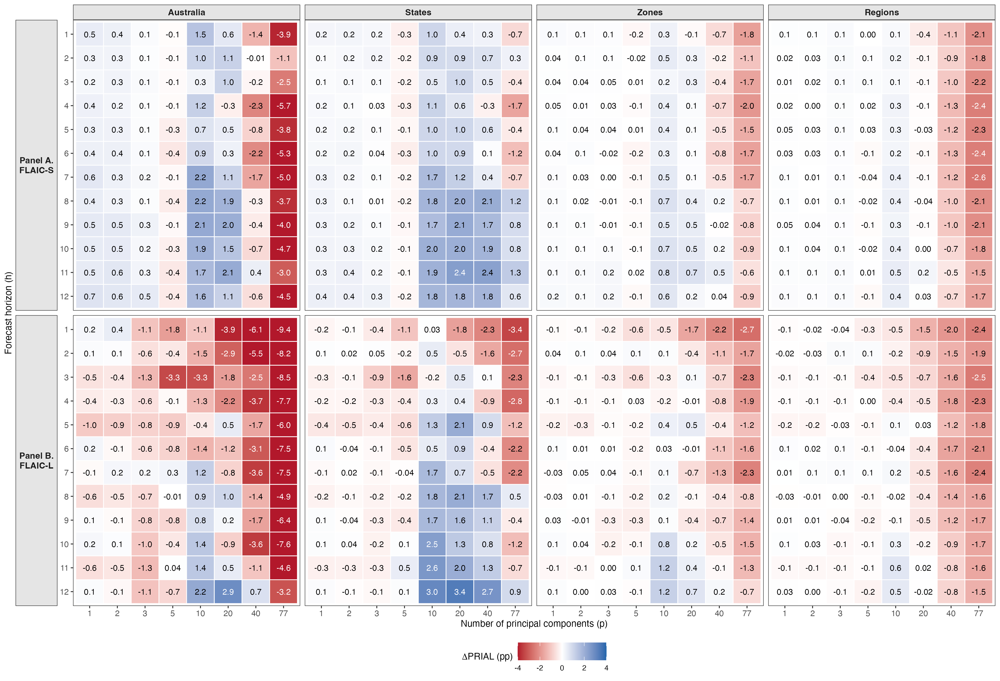
```

```{=latex}
\begin{center}
\begin{minipage}{0.90\linewidth}
\footnotesize\textit{Notes:} Entries report $\Delta$PRIAL in percentage points, defined as PRIAL(IComb) minus PRIAL(FLAIC), so positive values indicate lower MSFE for FLAIC. Panel A compares FLAIC-S with IComb-S, while Panel B compares FLAIC-L with IComb-L. Columns report results for Australia, States, Zones and Regions.
\end{minipage}
\end{center}
\vspace{0.8em}
```

```{r}
#| label: fig-prial-hierarchy-uc-us
#| echo: false
#| fig-cap: "PRIAL of FLAIC relative to matching IComb by hierarchy level: Uncentred, unscaled PCA"
#| fig-pos: H
#| out-width: "100%"
#| fig-align: center

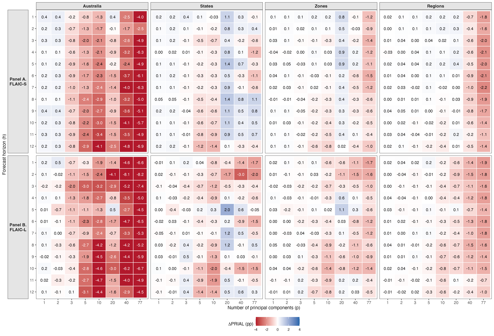
```

```{=latex}
\begin{center}
\begin{minipage}{0.90\linewidth}
\footnotesize\textit{Notes:} Entries report $\Delta$PRIAL in percentage points, defined as PRIAL(IComb) minus PRIAL(FLAIC), so positive values indicate lower MSFE for FLAIC. Panel A compares FLAIC-S with IComb-S, while Panel B compares FLAIC-L with IComb-L. Columns report results for Australia, States, Zones and Regions.
\end{minipage}
\end{center}
\vspace{0.8em}
```

```{r}
#| label: fig-prial-hierarchy-uc-s
#| echo: false
#| fig-cap: "PRIAL of FLAIC relative to matching IComb by hierarchy level: Uncentred, scaled PCA"
#| fig-pos: H
#| out-width: "100%"
#| fig-align: center

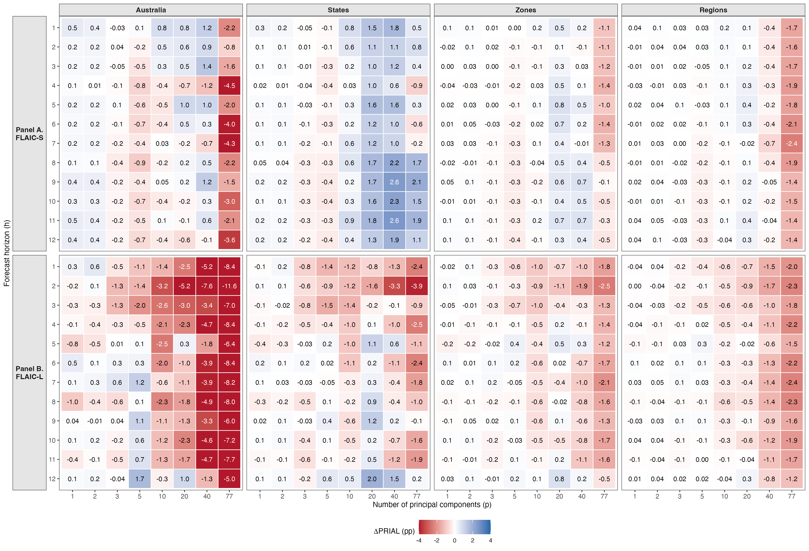
```

```{=latex}
\begin{center}
\begin{minipage}{0.90\linewidth}
\footnotesize\textit{Notes:} Entries report $\Delta$PRIAL in percentage points, defined as PRIAL(IComb) minus PRIAL(FLAIC), so positive values indicate lower MSFE for FLAIC. Panel A compares FLAIC-S with IComb-S, while Panel B compares FLAIC-L with IComb-L. Columns report results for Australia, States, Zones and Regions.
\end{minipage}
\end{center}
\vspace{0.8em}
```

## E. Multiple comparisons with the best for FLAIC: Other PCA Specifications {#sec-app-e}

```{r}
#| label: fig-mcb-centred-scaled
#| echo: false
#| fig-cap: "Multiple comparisons with the best for FLAIC"
#| fig-pos: H
#| out-width: "100%"
#| fig-align: center

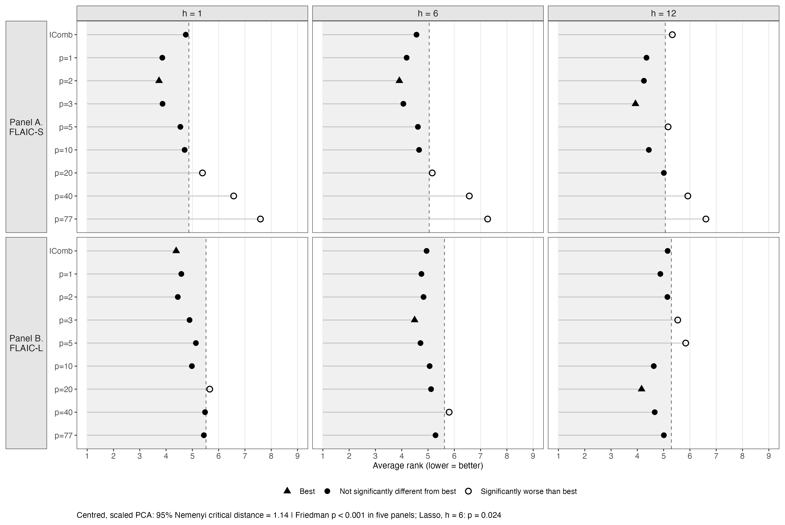
```

```{r}
#| label: fig-mcb-uncentred-unscaled
#| echo: false
#| fig-cap: "Multiple comparisons with the best for FLAIC"
#| fig-pos: H
#| out-width: "100%"
#| fig-align: center

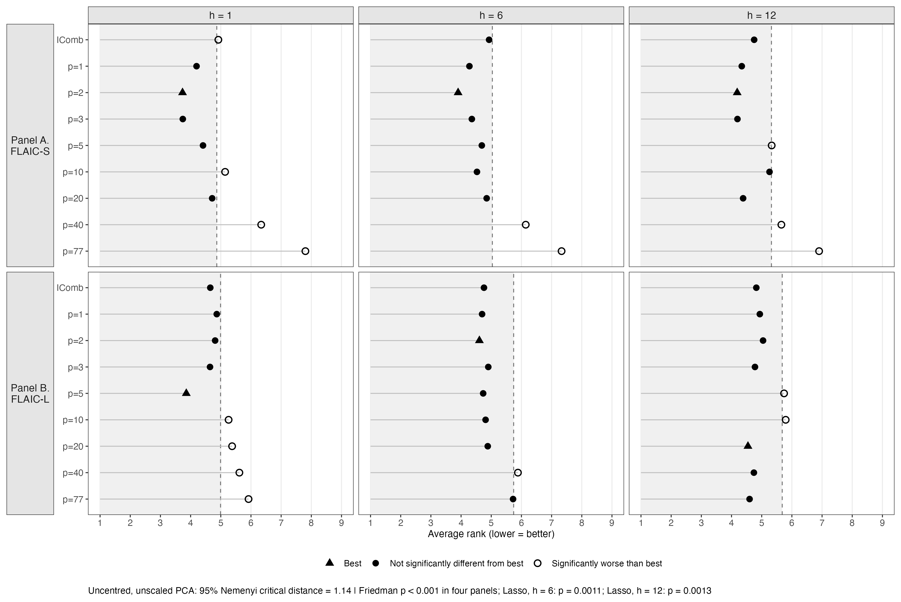
```

```{r}
#| label: fig-mcb-uncentred-scaled
#| echo: false
#| fig-cap: "Multiple comparisons with the best for FLAIC"
#| fig-pos: H
#| out-width: "100%"
#| fig-align: center

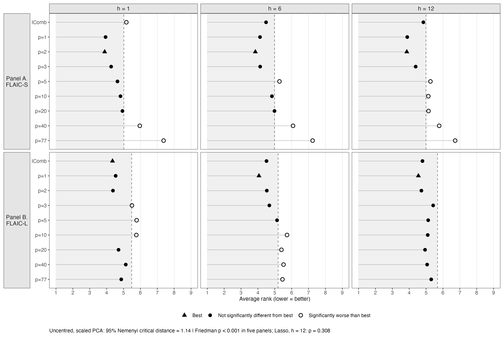
```

## F. PRIAL using scaled error {#sec-app-f}

@tbl-prial-snaive-average and @tbl-prial-variance-average report the PRIAL results for overall hierarchy using different accuracy measures, while @fig-prial-scaled-snaive and @fig-prial-scaled-variance give their heatmaps for $\Delta$ PRIAL.

```{=latex}
\FloatBarrier
```

```{r}
#| label: prial-scaled-table-helper
#| echo: false
#| message: false
#| warning: false

render_prial_scaled <- function(df, note_text, digits = 2) {

  value_cols <- c(paste0("h", 1:12), "h16", "h112")
  ridge_idx <- df$Family == "Ridge"
  lasso_idx <- df$Family == "Lasso"

  for (v in value_cols) {
    x <- df[[v]]
    z <- sprintf(paste0("%.", digits, "f"), x)

    best_ridge <- min(x[ridge_idx], na.rm = TRUE)
    hit <- ridge_idx & abs(x - best_ridge) <= 1e-10
    z[hit] <- paste0("\\textbf{", z[hit], "}")

    best_lasso <- min(x[lasso_idx], na.rm = TRUE)
    hit <- lasso_idx & abs(x - best_lasso) <= 1e-10
    z[hit] <- paste0("\\textbf{", z[hit], "}")

    best_all <- min(x, na.rm = TRUE)
    hit <- abs(x - best_all) <= 1e-10
    z[hit] <- paste0("\\underline{", z[hit], "}")

    df[[v]] <- z
  }

  df <- df %>%
    group_by(Family, Method) %>%
    mutate(Method_show = ifelse(row_number() == 1, Method, "")) %>%
    ungroup() %>%
    group_by(Family, Method, preprocessing) %>%
    mutate(preprocessing_show = ifelse(row_number() == 1, preprocessing, "")) %>%
    ungroup()

  pack_index <- setNames(rle(df$Family)$lengths, rle(df$Family)$values)

  display_df <- df %>%
    transmute(
      Method = Method_show,
      `PCA specification` = preprocessing_show,
      `$p$` = ifelse(is.na(p), "", as.character(p)),
      across(all_of(value_cols))
    )

  tab <- display_df %>%
    kableExtra::kbl(
      format = "latex",
      booktabs = TRUE,
      escape = FALSE,
      linesep = "",
      align = c("l", "l", "c", rep("r", 14)),
      col.names = c(
        "Method", "PCA specification", "$p$",
        as.character(1:12), "1--6", "1--12"
      )
    ) %>%
    kableExtra::add_header_above(
      data.frame(
        header = c("", "Forecast horizon ($h$)"),
        colspan = c(3, 14)
      ),
      escape = FALSE
    ) %>%
    kableExtra::pack_rows(index = pack_index, bold = TRUE) %>%
    kableExtra::kable_styling(
      latex_options = c("HOLD_position", "scale_down"),
      font_size = 6.5,
      position = "center"
    )

  tab_latex <- as.character(tab)
  tab_parts <- strsplit(tab_latex, "\\end{table}", fixed = TRUE)[[1]]

  cat(
    tab_parts,
    "\\vspace{0.15em}\n",
    "\\parbox{0.96\\linewidth}{\\scriptsize\\textit{Notes:} ",
    note_text,
    "}\n",
    "\\end{table}",
    sep = ""
  )
}
```

```{r}
#| label: tbl-prial-snaive-average
#| echo: false
#| message: false
#| warning: false
#| results: asis
#| tbl-cap: "PRIAL using seasonal-naive-scaled errors: Average"

df_snaive <- readRDS("rds/table_prial_scaled_snaive_average.rds")

note_snaive <- paste0(
  "Entries report PRIAL (\\%) relative to the ETS base forecasts, calculated using seasonal-naïve-scaled squared forecast errors as defined in Section~\ref{sec-design}. Lower values indicate better forecast performance, with negative values indicating lower scaled MSFE than the base forecasts. ",
  "The forecasts themselves are unchanged; only the loss used for evaluation is rescaled. ",
  "Columns 1--6 and 1--12 represent the short-term and long-term periods, respectively. ",
  "Bold values identify the best method within the ridge and lasso families, while underlined values identify the best method overall."
)

render_prial_scaled(df_snaive, note_snaive)
```

```{=latex}
\FloatBarrier
\clearpage
```

```{r}
#| label: tbl-prial-variance-average
#| echo: false
#| message: false
#| warning: false
#| results: asis
#| tbl-cap: "PRIAL using variance-standardised errors: Average"

df_variance <- readRDS("rds/table_prial_scaled_variance_average.rds")

note_variance <- paste0(
  "Entries report PRIAL (\\%) relative to the ETS base forecasts, calculated using variance-standardised squared forecast errors as defined in Section~\ref{sec-design}. Lower values indicate better forecast performance, with negative values indicating lower scaled MSFE than the base forecasts. ",
  "The forecasts themselves are unchanged; only the loss used for evaluation is rescaled. ",
  "Columns 1--6 and 1--12 represent the short-term and long-term periods, respectively. ",
  "Bold values identify the best method within the ridge and lasso families, while underlined values identify the best method overall."
)

render_prial_scaled(df_variance, note_variance)
```

```{r}
#| label: fig-prial-scaled-snaive
#| echo: false
#| message: false
#| warning: false
#| fig-cap: "PRIAL of FLAIC relative to matching IComb using seasonal-naive-scaled errors: Average"
#| fig-pos: H
#| out-width: "100%"
#| fig-align: center

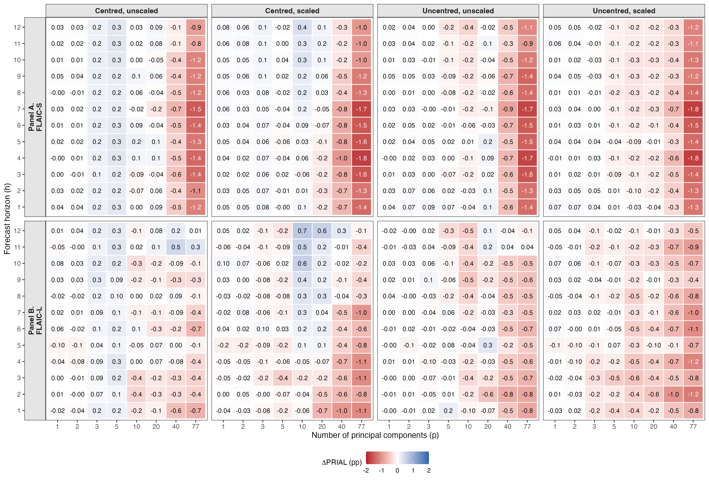
```

```{=latex}
\begin{center}
\begin{minipage}{0.92\linewidth}
\footnotesize\textit{Notes:} Entries report $\Delta\text{PRIAL}$ in percentage points, calculated using scaled squared forecast errors. Positive values indicate lower mean squared scaled forecast error for FLAIC relative to the corresponding IComb benchmark. Panel A compares FLAIC-S with IComb-S, while Panel B compares FLAIC-L with IComb-L. Columns show the four PCA preprocessing specifications.
\end{minipage}
\end{center}
\vspace{0.8em}
```

```{r}
#| label: fig-prial-scaled-variance
#| echo: false
#| message: false
#| warning: false
#| fig-cap: "PRIAL of FLAIC relative to matching IComb using variance-standardised errors: Average"
#| fig-pos: H
#| out-width: "100%"
#| fig-align: center

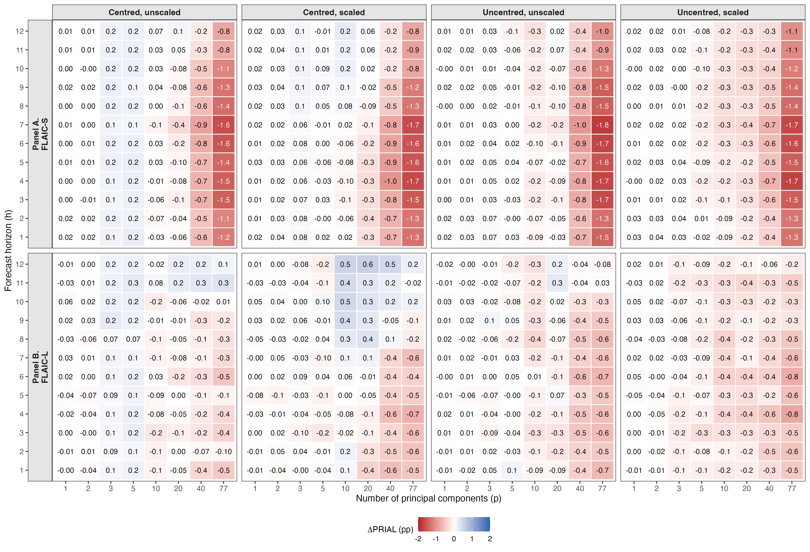
```

```{=latex}
\begin{center}
\begin{minipage}{0.92\linewidth}
\footnotesize\textit{Notes:} Entries report $\Delta\text{PRIAL}$ in percentage points, calculated using scaled squared forecast errors. Positive values indicate lower mean squared scaled forecast error for FLAIC relative to the corresponding IComb benchmark. Panel A compares FLAIC-S with IComb-S, while Panel B compares FLAIC-L with IComb-L. Columns show the four PCA preprocessing specifications.
\end{minipage}
\end{center}
\vspace{0.8em}

```